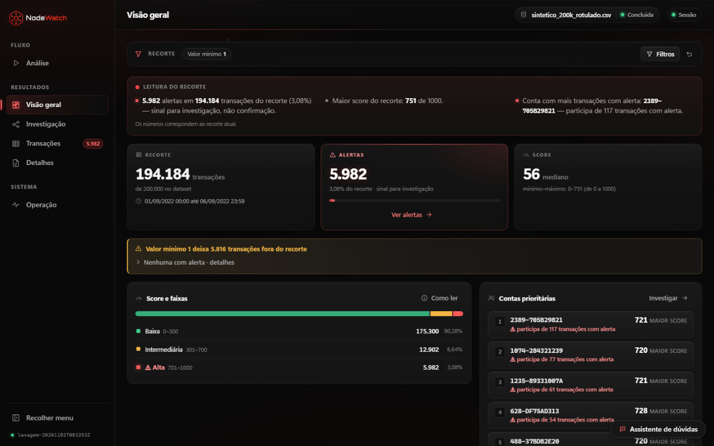

# NodeWatch

**Priorização de investigações de lavagem de dinheiro com Machine Learning e grafos.**

    

O NodeWatch lê um arquivo de transações financeiras, pontua cada transação com um modelo de Machine Learning
treinado no IBM AML HI-Small (dados sintéticos) e entrega ao analista uma fila de prioridades: score de 0 a 1000,
alertas com motivos verificáveis, contas que concentram alertas e o grafo de quem enviou e recebeu o dinheiro.
**Ele não bloqueia nem aprova nada**: o score indica o que investigar primeiro, e a decisão é sempre do analista.

Projeto acadêmico de Ciência da Computação (Grupo 4), orientado pela Profa. Dra. Andrea Ono Sakai.
Site de apresentação: [nodewatch-team.github.io/NodeWatch](https://nodewatch-team.github.io/NodeWatch/).



---

## Como funciona

```mermaid
flowchart LR
    A["CSV ou ZIP de transações<br/>(formato IBM AML ou em português)"] --> B["Validação em blocos<br/>linhas inválidas ficam fora e são contadas"]
    B --> C["Ordem cronológica"]
    C --> D["49 atributos por transação<br/>só com o passado de cada conta"]
    D --> E["Random Forest<br/>modelos/modelo_unificado.joblib"]
    E --> F["Score 0–1000<br/>alerta a partir de 701 + motivos"]
    F --> G[("resultados.sqlite<br/>+ manifesto.json")]
    G --> H["Painel do analista<br/>visão geral · contas · grafo · tabela"]
```



1. **Validação.** Datas, bancos, contas, valores e moedas são conferidos linha a linha. Nada é corrigido nem
   inventado: cada problema vem com a coluna, uma linha de exemplo e como corrigir.
2. **Atributos.** Para cada transação, o sistema mantém o estado de cada conta e calcula 49 atributos usando só
   transações de minutos anteriores: contagens e somas em janelas de 6, 24 e 72 h, tempo desde o último
   recebimento, desvio do valor, se o par de contas é novo, quantas contrapartes distintas cada conta tem,
   formato de pagamento e moeda.
3. **Modelo.** Um Random Forest (scikit-learn, 100 árvores) devolve um valor de 0 a 1. Ele não é uma
   probabilidade calibrada: o painel o converte numa escala de prioridade de 0 a 1000, em que **701 corresponde
   exatamente ao limiar de alerta** escolhido na validação.
4. **Investigação.** Os resultados ficam num SQLite por análise. O painel filtra e pagina no servidor, ordena
   as contas pela quantidade de alertas e desenha a rede da conta em foco, salto a salto, mostrando quais
   repasses têm horários compatíveis.

O **Assistente de dúvidas** (tecnologia Sentinel AI) explica a análise aberta: responde localmente, sem serviço
externo, e, com a sua autorização e uma chave de API, usa o Gemini ou a Anthropic com o contexto verificado.

---

## Início rápido

Precisa de **Python 3.12 ou mais novo** (testado no 3.14) e de internet no primeiro uso, para instalar as
bibliotecas. Não precisa de GPU, do dataset nem de chave de API.

| Sistema | Comando |
|---|---|
| Windows | clique duas vezes em **`iniciar.bat`** |
| Linux e macOS | `./iniciar.sh` |

O inicializador cria o `.venv`, instala as dependências, instala e confere o modelo e sobe o servidor. Depois:

| endereço | o que é |
|---|---|
| `http://127.0.0.1:5000/` | **Painel do analista**, a interface do NodeWatch |
| `http://127.0.0.1:5000/health` | situação do servidor e do Sentinel AI |

Para testar sem dados próprios, escolha `transacoes_inventadas.csv` na lista de datasets do painel, valide e
clique em **Analisar**.

<details>
<summary><b>Instalação manual (terminal)</b></summary>

```bash
git clone https://github.com/NodeWatch-Team/NodeWatch.git
cd NodeWatch
python -m venv .venv
.venv/bin/python -m pip install -r requirements.txt -r requirements-ml.txt     # Windows: .venv\Scripts\python
.venv/bin/python src/servidor.py
```

Ao iniciar, o servidor instala o modelo de `modelos/` em `artefatos_ml/` (pasta de trabalho, fora do Git) e
confere o SHA-256. Saída esperada:

```
[OK] Modelo de ML pronto: lavagem-20261102T083253Z (instalado agora a partir de modelos/); 49 atributos; limiar de alerta 0.0910.
```

</details>

<details>
<summary><b>Chave do Sentinel AI (opcional)</b></summary>

Copie `.env.example` para `.env` e preencha `GEMINI_API_KEY` (ou `SENTINEL_PROVIDER=anthropic` e
`ANTHROPIC_API_KEY`). Sem chave, o painel funciona inteiro e o assistente responde no modo local. O `.env` está no
`.gitignore` e a chave nunca aparece na tela nem nos logs. No Windows, o `iniciar.bat` pergunta o token uma vez.
Detalhes em [`docs/SENTINEL_AI.md`](docs/SENTINEL_AI.md).

| variável | padrão | para que serve |
|---|---|---|
| `GEMINI_API_KEY` | (vazia) | ativa o Sentinel AI com o Gemini |
| `SENTINEL_PROVIDER` | `gemini` | `gemini` ou `anthropic` |
| `GEMINI_MODEL` | `gemini-2.5-flash` | modelo usado |
| `SENTINEL_HOST` / `SENTINEL_PORT` | `127.0.0.1` / `5000` | endereço do servidor |

</details>

---

## Formato de entrada

CSV em UTF-8, separado por vírgula (ou um `.zip` com um único CSV), sem limite de tamanho. Dois cabeçalhos são
aceitos ([`src/ml/formatos.py`](src/ml/formatos.py)):

| formato | cabeçalho | rótulo opcional |
|---|---|---|
| IBM AML | `Timestamp,From Bank,Account,To Bank,Account,Amount Received,Receiving Currency,Amount Paid,Payment Currency,Payment Format` | `Is Laundering` |
| Português | `id_transacao,timestamp,banco_origem,conta_origem,banco_destino,conta_destino,valor_pago,moeda_pagamento,valor_recebido,moeda_recebimento,formato` | `rotulo` |

Com o rótulo, o painel mostra também precisão e recall daquele arquivo. Regras completas em
[`docs/ui/PAINEL_ANALISTA.md`](docs/ui/PAINEL_ANALISTA.md).

---

## Resultados do modelo

Teste congelado do IBM AML HI-Small (09 e 10/09/2022, 862.792 transações, 0,11% de lavagem), avaliado uma vez com
o modelo escolhido na validação ([`docs/ml/RELATORIO_ML.md`](docs/ml/RELATORIO_ML.md)):

| métrica | valor | leitura |
|---|---|---|
| Average precision (PR-AUC) | **0,464** | um palpite ao acaso daria 0,001 |
| Precisão no limiar | 0,627 | 389 de 620 alertas eram lavagem |
| Recall no limiar | 0,407 | de 0,55 a 0,72 nas 8 tipologias do simulador; 0,02 nos positivos sem tipologia |
| Falsos alertas | 2,7 por 10 mil transações | 231 no período |

Os números valem para dados sintéticos e não se transferem automaticamente para dados reais.

---

## Estrutura do repositório

```
NodeWatch/
├── iniciar.bat, iniciar.sh  início com um comando (Windows / Linux e macOS)
├── src/
│   ├── servidor.py          servidor Flask: painel em /, API em /api/painel, /health
│   ├── seguranca_local.py   só aceita pedidos locais e da própria página
│   ├── sentinel_ia.py       motor do Sentinel AI (provedores e prompts)
│   ├── painel/              API, pipeline da análise, datasets, SQLite, score, sessões, assistente, logs
│   ├── ml/                  atributos, modelo, inferência e instalação do modelo (usado pelo servidor)
│   └── treino/              treino e avaliação offline (python -m src.treino.cli)
├── interface/               painel do analista (painel.html + assets, React 18 sem build)
├── modelos/                 modelo distribuído, manifesto com SHA-256, metadados e avaliação
├── dados/exemplos/          transações inventadas para testar o painel
├── testes/                  testes do painel e do módulo de ML
├── scripts/                 inicializador do Windows, ambiente de teste, exemplos e imagens do site
├── pesquisa/                estudos que não entram no modelo distribuído (HI-Large, atributos de grafo)
├── docs/                    manual, ML, interface, decisões, marca e material acadêmico
└── index.html, site-assets/ site de apresentação (GitHub Pages)
```

| quero... | leia |
|---|---|
| entender o sistema inteiro | [`docs/COMO_FUNCIONA_O_NODEWATCH.md`](docs/COMO_FUNCIONA_O_NODEWATCH.md) |
| usar e conhecer o painel | [`docs/ui/PAINEL_ANALISTA.md`](docs/ui/PAINEL_ANALISTA.md) |
| treinar, avaliar ou entender o modelo | [`docs/ml/README.md`](docs/ml/README.md) e [`docs/ml/RELATORIO_ML.md`](docs/ml/RELATORIO_ML.md) |
| saber como o modelo chega à máquina | [`modelos/README.md`](modelos/README.md) |
| entender por que o modelo usa só grafo de 1 salto | [`docs/decisoes/0001-grafos-e-ml.md`](docs/decisoes/0001-grafos-e-ml.md) |
| apresentar o projeto | [`docs/APRESENTACAO_NODEWATCH.md`](docs/APRESENTACAO_NODEWATCH.md) |

---

## Desenvolvimento

```bash
python -m pytest -q                       # 319 testes, dados sintéticos, nenhum precisa do HI-Small nem de chave
python scripts/ambiente_teste.py          # painel de teste em http://127.0.0.1:5001/, numa pasta isolada (artefatos_teste/)
python -m src.treino.cli --help           # auditar, treinar, avaliar, prever, relatorio (precisa do HI-Small)
```

O ambiente de teste traz datasets sintéticos prontos (5 mil e 200 mil transações, com e sem rótulo) e não toca
em `artefatos_ml/`. Para treinar de novo, baixe o IBM AML no
[Kaggle](https://www.kaggle.com/datasets/ealtman2019/ibm-transactions-for-anti-money-laundering-aml) (licença
CDLA-Sharing-1.0), copie `ml_config.exemplo.toml` para `ml_config.local.toml` e aponte os caminhos.

<details>
<summary><b>Erros comuns</b></summary>

| mensagem | causa | o que fazer |
|---|---|---|
| `Bibliotecas de ML ausentes` | só o `requirements.txt` foi instalado | `python -m pip install -r requirements.txt -r requirements-ml.txt` |
| `Versões incompatíveis com o modelo distribuído` | outra versão do scikit-learn no ambiente | instale as versões fixadas num `.venv` novo |
| `… não confere com o SHA-256 do manifesto` | cópia incompleta do repositório | `git checkout -- modelos/` ou `python -m src.ml.provisionamento` com internet |
| `foi salvo por uma versão anterior do NodeWatch` | modelo antigo em `artefatos_ml/` | inicie o servidor (ele troca o modelo) ou rode `python -m src.ml.provisionamento` |
| análise sem nenhum alerta | o arquivo começa sem histórico: nas primeiras ~72 h as contas ainda "não têm passado" | use arquivos com vários dias, ou `python -m src.treino.cli prever --historico …` |
| `A porta 5000 está ocupada` | outro servidor na mesma porta | feche-o com Ctrl+C na janela dele |

</details>

---

## Limitações

- Protótipo acadêmico, treinado e avaliado em dados **sintéticos**; não é um sistema de produção.
- O score é uma ordem de prioridade, não probabilidade calibrada nem prova de lavagem.
- O painel só conhece o histórico que está no próprio arquivo; no começo do período os alertas ficam subestimados
  (a tela avisa).
- Uma análise por vez, com o dataset validado em memória durante a análise.
- Não há explicação por transação do modelo: os motivos mostrados são fatos verificáveis por regras fixas.

---

## Equipe

- Caio Winkler Marangoni — 39968545
- Guilherme Lombardi — 38054264
- Ryan dos Santos Veloso — 37732005
- Guilherme Libório Camargo — 48490181

Licença [MIT](LICENSE). Dados de treino: IBM Transactions for Anti Money Laundering (AML), CDLA-Sharing-1.0.
