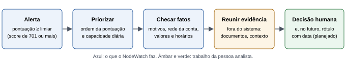
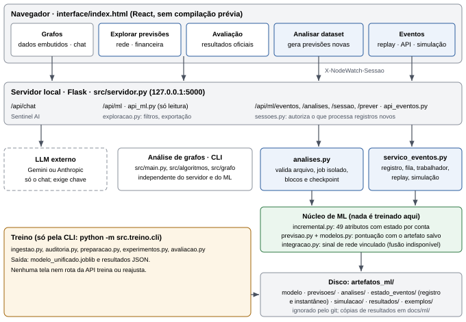
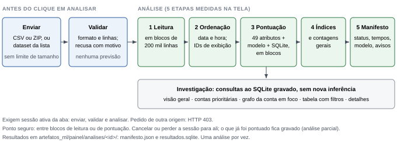
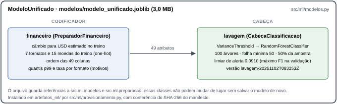
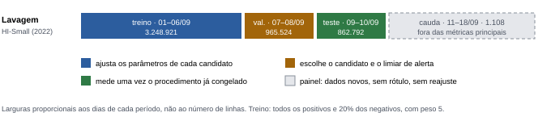

<!--capa
rotulo: Manual técnico e didático
titulo: Como funciona o NodeWatch
sub: O que o sistema faz, como uma análise é feita, como o Machine Learning é usado e o que os resultados permitem concluir.
Projeto: NodeWatch — priorização de investigações de lavagem de dinheiro (Grupo 4)
Integrantes: Caio Winkler Marangoni, Guilherme Lombardi, Ryan dos Santos Veloso, Julia Emily Leonardo Barbosa e Guilherme Liborio Camargo
Versão documentada: main de 17/11/2026, depois da reorganização do repositório
Modelo: lavagem-20261102T083253Z (não foi retreinado para este manual)
Data: 17/11/2026
-->

# Como funciona o NodeWatch

**Como ler este manual.** A Parte I é para quem nunca trabalhou com Machine Learning: explica o problema, os dados e como ler um resultado, e traz um tutorial completo. A Parte II traz os detalhes para manter o sistema: arquitetura, fórmulas, formatos, garantias, resultados e arquivos. Os termos são explicados no primeiro uso e reunidos no glossário (seção 15).

**De onde vêm as afirmações.** A fonte é o código atual. Cada resultado indica a origem:

| Marca | Significado |
|---|---|
| **Verificado agora** | Executado em 17/11/2026, na versão documentada, para este manual. |
| **Evidência existente** | Resultado salvo de uma execução anterior, com a data. O código correspondente não mudou desde então, salvo indicação. |

**Nenhum modelo foi retreinado** para escrever este documento.

# Parte I — Para entender o sistema

# 1 O que é o NodeWatch

## 1.1 O problema

O NodeWatch é um protótipo acadêmico que ajuda uma pessoa analista a decidir **o que investigar primeiro** em transações financeiras.

A ideia original vem da disciplina de Teoria dos Grafos. Um grafo é um conjunto de pontos ligados por setas: se cada conta é um ponto e cada transação é uma seta, certos desenhos chamam atenção, como o dinheiro que entra numa conta e sai logo em seguida para contas novas. Depois foi acrescentado o ML (*Machine Learning*, aprendizado de máquina): um programa que aprende com exemplos em vez de seguir regras escritas à mão. Hoje as duas ideias trabalham juntas: o modelo recebe medidas de grafo entre os seus atributos, e o painel mostra o grafo para a investigação.

> **O NodeWatch não prova lavagem nem fraude.** Um alerta é um pedido de atenção, não um veredito. A decisão é sempre de uma pessoa, com outras evidências.



## 1.2 Três coisas que não se confundem

| Termo | O que significa aqui | O que **não** é |
|---|---|---|
| **Comportamento suspeito** | Fato conferível sobre uma transação ou uma conta: par de contas novo, repasse logo depois de receber, muitas contrapartes. | Não é ilícito por si: folhas de pagamento e comércios também criam esses desenhos. |
| **Alerta de lavagem** | Score de 701 ou mais, o que equivale a passar do limiar aprendido em dados **sintéticos** de lavagem de dinheiro. | Não é probabilidade calibrada, não é fraude confirmada, e lavagem não representa todos os tipos de fraude. |
| **Fraude confirmada** | Conclusão de uma investigação humana, com evidência e data. | Nenhum dado do projeto tem esse rótulo. Nenhum componente produz essa conclusão. |

## 1.3 O que existe hoje

| Componente | Situação | Observação |
|---|---|---|
| Painel do analista (envio, validação, análise, investigação, desempenho, logs) | Implementado e verificado | `http://127.0.0.1:5000/`, funciona sem chave de API. |
| Modelo de lavagem (Random Forest) | Implementado e verificado | Distribuído em `modelos/`, instalado com conferência de SHA-256. Medido só em dados sintéticos. |
| Grafo da conta em foco | Implementado e verificado | Consulta ao SQLite da análise; até 3 saltos. |
| Treino e avaliação | Implementado; **não refeito** para este manual | Só pela linha de comando, com o HI-Small. |
| Assistente de dúvidas (Sentinel AI) | Modo local verificado; **com chave real, não verificado** | O modelo de linguagem é externo e opcional. |
| XGBoost | Avaliado em scripts isolados; **não implementado** | Não está no código nem nas dependências. |
| Fonte de dados ao vivo, autenticação | **Não existem** | O servidor é feito para rodar em `127.0.0.1`. |

**Removido em 17/11/2026** (continua no histórico do Git): a interface antiga, a linha de comando de grafos (ciclos por DFS, componentes fortemente conexos e centralidade), o processamento de eventos e o módulo didático de telemetria de rede. A decisão sobre os grafos está em [`decisoes/0001-grafos-e-ml.md`](decisoes/0001-grafos-e-ml.md).

# 2 Que dados o sistema recebe

| Dado | O que é | Quem usa |
|---|---|---|
| Transações com banco, moeda e data | Formato do IBM AML ou o mesmo em português (seção 9) | Painel e modelo de lavagem |
| Rótulo (opcional) | `Is Laundering` ou `rotulo`, 0 ou 1 | Só para mostrar precisão e recall daquele arquivo; nunca entra no modelo |
| Perguntas ao assistente | Texto digitado no Assistente de dúvidas | Sentinel AI |

O modelo foi treinado no **IBM AML HI-Small**: 5.078.345 transações **sintéticas** de 01 a 18/09/2022, geradas por um simulador (Altman et al., 2023), com 5.177 marcadas como lavagem pelo próprio simulador. Não são transações bancárias reais. O arquivo não vem no repositório (é grande e tem licença própria, CDLA-Sharing-1.0): ele só é necessário para treinar de novo.

# 3 O que acontece numa análise

Exemplo: você tem um arquivo de transações e quer saber quais merecem atenção.

1. **Você abre o painel.** A página abre uma **sessão**, uma espécie de crachá que diz "há alguém usando esta aba". Nada é analisado.
2. **Você envia o arquivo, ou escolhe um da lista, e ele é validado.** O servidor confere colunas, datas e valores, linha a linha. Linhas ruins ficam de fora, com o motivo; nada é preenchido. Ainda não há previsão.
3. **Você clica em Analisar.** Só agora o trabalho começa, em cinco etapas que a tela acompanha.
4. **O sistema põe as transações em ordem de tempo** e cria um estado vazio das contas, só desta análise.
5. **Para cada transação, calcula atributos.** Atributos são números que descrevem o contexto: quanto essa conta enviou nas últimas 24 horas, se o destino é novo, se o valor foge do costume dela. Só entra o que aconteceu **antes** daquele minuto.
6. **O modelo dá uma nota.** O modelo já treinado recebe os 49 atributos e devolve um número entre 0 e 1. Nada é treinado aqui.
7. **A nota vira um score de 0 a 1000.** A partir de 701 (o limiar do modelo), a transação vira **alerta** e ganha motivos conferíveis.
8. **Tudo é gravado** num banco SQLite da análise, e o estado das contas avança. Atualizar o estado não é treinar: o modelo não muda.
9. **Você investiga** na visão geral, nas contas prioritárias, no grafo e na tabela. Filtrar e paginar consultam o que foi gravado, sem refazer nenhum cálculo.

## 3.1 Como o modelo chega a uma nota

O modelo é uma **Random Forest** (floresta aleatória): um conjunto de 100 árvores de decisão. Uma árvore é uma sequência de perguntas sobre os atributos, como "o par origem→destino é novo?" e "enviou mais de X em 24 h?". Cada árvore aprendeu suas perguntas com uma parte diferente dos exemplos do treino. A nota final é a média das respostas de todas.

Isso é **aprendizado supervisionado**: o modelo aprendeu com exemplos cuja resposta era conhecida.

## 3.2 Como ler um resultado

| O que você vê | Como ler |
|---|---|
| **Score** de 0 a 1000 | Ordem de prioridade. Serve para **ordenar** a fila. Um score de 800 não quer dizer "80% de chance". |
| Faixa **baixa** (0–300), **intermediária** (301–700) ou **alta** (701–1000) | A alta é exatamente o conjunto dos alertas. A intermediária é o trecho logo abaixo do limiar. |
| **Motivos** | Fatos que você pode conferir, como "primeira transação entre origem e destino". **Não** explicam a decisão do modelo. |
| **Histórico incompleto** | Menos de 72 h de observação no próprio arquivo antes da transação: os atributos de contagem estão subestimados. |
| Sem alerta | Não quer dizer "seguro". No teste oficial, 59% da lavagem sintética não gerou alerta. |
| **Contas prioritárias** | Contas que participam de mais transações em alerta no recorte. Não existe score por conta. |

## 3.3 Quais conclusões os dados permitem

**Permitem:** dizer que, **nos dados sintéticos do HI-Small**, o modelo ordena a lavagem muito melhor que regras simples; e conferir, num arquivo de transações, para onde o dinheiro de uma conta seguiu.

**Ainda não permitem:** afirmar desempenho em transações reais de um banco ou em outra população; detectar fraude em geral (o rótulo é só **lavagem sintética**); tratar uma pequena diferença de métrica como melhoria comprovada (seção 13.4).

# 4 Tutorial completo com dados inventados

> **Tudo aqui é inventado.** Contas, bancos, valores e datas foram criados à mão em `dados/exemplos/transacoes_inventadas.csv` só para ilustrar o formato e a leitura. Os scores abaixo não dizem nada sobre o desempenho do modelo.

**Verificado agora**: as saídas abaixo são as reais, com o modelo distribuído.

**Passo 1 — Iniciar.** Clique duas vezes em `iniciar.bat` (Windows) ou rode `./iniciar.sh` (Linux e macOS). O navegador abre em `http://127.0.0.1:5000/`. O ponto verde de **Sessão**, no topo, mostra que a aba está autorizada. Nada começou.

**Passo 2 — O arquivo.** A história inventada: a conta `MERCADO1` faz pagamentos pequenos e regulares. No dia 13, recebe 48.000 de `ORIGEM9` e, em minutos, repassa quase tudo a duas contas novas, com recebimento em outra moeda. As últimas três linhas são erros de propósito.

```text
id_transacao,timestamp,banco_origem,conta_origem,banco_destino,conta_destino,valor_pago,moeda_pagamento,valor_recebido,moeda_recebimento,formato
tx-001,2025-03-10T09:00:00Z,301,MERCADO1,302,FORNEC01,120.5,US Dollar,120.5,US Dollar,ACH
...
tx-009,2025-03-13T10:00:00Z,309,ORIGEM9,301,MERCADO1,48000.0,US Dollar,48000.0,US Dollar,ACH
tx-010,2025-03-13T10:05:00Z,301,MERCADO1,310,NOVA0001,23500.0,US Dollar,23500.0,Euro,ACH
tx-011,2025-03-13T10:06:00Z,301,MERCADO1,311,NOVA0002,23400.0,US Dollar,23400.0,Euro,ACH
tx-012,2025-03-13T10:07:00Z,310,NOVA0001,301,MERCADO1,900.0,US Dollar,900.0,US Dollar,ACH
tx-013,ontem,301,MERCADO1,302,FORNEC01,10.00,US Dollar,10.00,US Dollar,ACH
tx-014,2025-03-13T11:00:00Z,301,MERCADO1,302,FORNEC01,-5.00,US Dollar,5.00,US Dollar,ACH
tx-001,2025-03-10T09:00:00Z,301,MERCADO1,302,FORNEC01,120.5,US Dollar,120.5,US Dollar,ACH
```

**Passo 3 — Validar.** Na vista **Análise**, em *Escolher dataset*, selecione `transacoes_inventadas.csv`. O resumo da validação mostra:

| Campo | Valor | Leitura |
|---|---|---|
| Formato | colunas em português (`transacao_hismall_v1`) | Reconhecido pelas colunas, não pelo nome. |
| Linhas | 15 lidas, 12 válidas, 3 recusadas | |
| Recusas | data e hora em formato não aceito (1), valor pago negativo (1), identificador repetido (1) | Nada é corrigido nem preenchido. |
| Período | 10/03/2025 09:00 a 13/03/2025 10:07 | |
| Rótulo | ausente | Precisão e recall ficarão indisponíveis. |

**Passo 4 — Analisar.** Clique em **Analisar**. O acompanhamento mostra as cinco etapas (leitura, ordenação, pontuação, índices, manifesto) e termina em **Análise concluída**, em menos de um segundo.

**Passo 5 — Ler o resultado.** Em **Ver resultados → Transações** (ordenado por data e hora; TX-n é o ID de exibição):

| ID | Transação | Quando | Origem → destino | Valor | Score | Valor bruto | Hist. incompleto |
|---|---|---|---|---|---|---|---|
| TX-1 | tx-001 | 10/03 09:00 | MERCADO1 → FORNEC01 | 120,50 | 1 | 0,00025 | sim |
| TX-5 | tx-005 | 12/03 09:00 | MERCADO1 → FORNEC01 | 110,00 | 11 | 0,00145 | sim |
| TX-6 | tx-006 | 12/03 09:00 | CLIENTE7 → MERCADO1 | 45,90 | 0 | 0,00001 | sim |
| TX-8 | tx-008 | 13/03 09:00 | MERCADO1 → FORNEC01 | 125,60 | 2 | 0,00037 | não |
| TX-9 | tx-009 | 13/03 10:00 | ORIGEM9 → MERCADO1 | 48.000,00 | 42 | 0,00553 | não |
| TX-10 | tx-010 | 13/03 10:05 | MERCADO1 → NOVA0001 | 23.500,00 | 132 | 0,01723 | não |
| TX-11 | tx-011 | 13/03 10:06 | MERCADO1 → NOVA0002 | 23.400,00 | 177 | 0,02307 | não |
| TX-12 | tx-012 | 13/03 10:07 | NOVA0001 → MERCADO1 | 900,00 | 122 | 0,01591 | não |

(As demais linhas têm scores de 6 a 32, todas na faixa baixa.)

O que dá para aprender com isso:

1. **O repasse aumentou a nota, mas não houve alerta.** O score subiu de perto de 0 para 177, ainda longe de 701. Sem alerta não quer dizer "seguro".
2. **O modelo reage a padrões do conjunto em que foi treinado.** Uma história que parece suspeita para uma pessoa pode não se parecer com o que o simulador gerou. E o inverso também vale.
3. **TX-5 e TX-6 estão no mesmo minuto.** Nenhuma enxerga a outra, por construção.
4. **Sem rótulo**, a tela diz que precisão e recall não estão disponíveis para este dataset: sem saber a resposta certa, não há como calcular acerto.
5. **As 7 primeiras linhas saem com histórico incompleto**, porque a observação começou há menos de 72 h. A tela mostra um aviso com essa contagem.

**Passo 6 — Investigar.** Na vista **Investigação**, escolha `301-MERCADO1`: o grafo mostra a ida e a volta MERCADO1 → NOVA0001 → MERCADO1 como uma sequência com horários compatíveis.

Os resultados ficam em `artefatos_ml/painel/analises/<id>/` (`manifesto.json` e `resultados.sqlite`) e continuam disponíveis depois de reiniciar o servidor. O painel guarda as 20 análises mais recentes; as mais antigas são removidas quando uma nova começa.

# Parte II — Referência técnica

# 5 Arquitetura

## 5.1 Componentes



| Componente | Onde | Papel |
|---|---|---|
| Painel | `interface/painel.html`, `interface/assets/` | Página React 18 sem etapa de compilação (sem JSX); grafo desenhado em SVG. |
| Servidor | `src/servidor.py` (Flask) | Serve a página, a API do painel e `/health`; instala o modelo ao iniciar. |
| Acesso local | `src/seguranca_local.py` | Recusa `Host` não local e pedidos de outra origem à API. |
| API do painel | `src/painel/api.py` | Rotas `/api/painel/*`: sessão, datasets, análises, consultas, operação, assistente. |
| Sessões | `src/painel/sessoes.py` | Quem autoriza processar. |
| Datasets | `src/painel/datasets.py`, `src/ml/formatos.py` | Envio em blocos, catálogo e validação. |
| Análise | `src/painel/pipeline.py` | Cinco etapas medidas, cancelamento, manifesto. |
| Atributos | `src/ml/incremental.py` (estado por conta), `src/ml/preparacao.py` (lote, para o treino) | Os mesmos 49 atributos. |
| Modelo | `src/ml/modelos.py`, `previsao.py`, `provisionamento.py`, `modelo_ativo.py` | Artefato, pontuação, instalação e carga. |
| Score e resultados | `src/painel/score.py`, `armazenamento.py` | Escala 0–1000; SQLite, filtros, contas, grafo. |
| Operação | `src/painel/sistema.py` | CPU, RAM, latência, logs em JSONL. |
| Assistente | `src/painel/assistente.py`, `contexto_sentinel.py`, `src/sentinel_ia.py` | Respostas locais; Sentinel AI opcional. |
| Treino | `src/treino/` | Auditoria, treino, avaliação, previsão em arquivo e relatório. |

## 5.2 Caminho dos dados



| Etapa da tela | O que faz | Unidade do progresso |
|---|---|---|
| 1 Leitura e validação | Lê o arquivo em blocos de 200 mil linhas e separa as linhas válidas | bytes lidos |
| 2 Ordenação | Ordena por minuto e, no empate, pela ordem da linha; atribui o ID de exibição | — |
| 3 Atributos, inferência e gravação | Em blocos de cerca de 20 mil transações cortados na virada do minuto: atributos, modelo, score e gravação no SQLite | transações |
| 4 Índices e contagens | Cria os índices dos campos filtráveis e as contagens gerais | passos |
| 5 Manifesto | Grava o manifesto final (status, tempos, modelo, avisos) | — |

A estimativa de tempo restante só aparece com base medida (pelo menos 3 s de etapa e algum progresso): o que falta ÷ vazão observada. O cancelamento é atendido no próximo ponto seguro, entre blocos; o que já foi pontuado fica gravado e consultável (análise **parcial**).

## 5.3 O que roda onde

| Onde | O que acontece |
|---|---|
| **Navegador** | Desenho das telas; consultas ao servidor; pulso da sessão a cada 15 s. |
| **Servidor local** | Validação, atributos, modelo, gravação, filtros, grafo, medidas de desempenho. |
| **Serviço externo** | Só o Sentinel AI, e só com chave e com a autorização da aba: envia a pergunta e o contexto verificado da análise ao Gemini (padrão) ou à Anthropic. |

Nada do painel precisa de internet: React está em `interface/assets/vendor`. A internet só é necessária no primeiro uso, para instalar as bibliotecas (e baixar o modelo, se o arquivo faltar).

## 5.4 Sentinel AI

O **Assistente de dúvidas** responde no **modo local**, sem serviço externo: glossário, ajuda de uso e números lidos dos resultados gravados. Com uma chave de API e a autorização na tela, ele passa a usar o **Sentinel AI**: um modelo de linguagem externo que recebe a pergunta e o contexto verificado (manifesto, recorte, transação em foco, métricas oficiais) e responde separando fatos, inferências, hipóteses e limitações. Detalhes em [`SENTINEL_AI.md`](SENTINEL_AI.md).

| | Sentinel AI | Modelo do NodeWatch |
|---|---|---|
| Tipo | LLM externo, geração de texto | Random Forest local, classificação |
| Saída | Texto explicativo | Score e alerta, reproduzíveis |
| Internet | Sim | Não |

O assistente explica; não detecta nada e não altera nenhum cálculo.

# 6 Atributos das transações

**Objetivo:** ordenar transações para que o que se parece com lavagem apareça primeiro. **Entrada:** seção 9. **Saída:** score, alerta e motivos.

## 6.1 Identidade das contas

Uma conta é `banco-conta`: o mesmo número em bancos diferentes são contas diferentes. Bancos precisam ser numéricos (zeros à esquerda não contam).

## 6.2 Janelas temporais

Cada janela é `[t − w, t)`, em minutos inteiros. O próprio minuto `t` fica de fora, porque o horário tem resolução de minuto e a ordem dentro dele não é confiável. Esse cuidado de só usar o passado se chama *point-in-time*.


## 6.3 Os 49 atributos

| Família | Atributos | Janela |
|---|---|---|
| Valor | `log_valor_usd` = log(1 + valor em USD); `sem_taxa_cambio` | transação |
| Envios da origem | `n_env_origem_6h/24h/72h`, `n_env_origem_total`, `soma_env_origem_usd_24h`, `min_desde_env_origem` | janela ou todo o passado |
| Valor atípico | `z_valor_origem` | todo o passado |
| Entrada e saída | `n_rec_origem_24h`, `soma_rec_origem_usd_24h`, `razao_saida_entrada_24h`, `min_desde_rec_origem` | 24 h ou passado |
| Destino | `n_env_destino_24h`, `n_rec_destino_24h/72h`, `min_desde_rec_destino` | 24 h, 72 h ou passado |
| Contrapartes (grafo de 1 salto) | `par_novo`, `n_par_previas`, `dest_distintos_origem`, `orig_distintas_destino` | todo o passado |
| Da transação | `moeda_diferente`, `mesmo_banco`, `auto_transferencia` | transação |
| Falta de histórico | `sem_historico_env_origem`, `sem_historico_rec_origem`, `sem_historico_rec_destino` | todo o passado |
| Categorias | `formato_*` (7), `moeda_*` (15), em one-hot (uma coluna 0/1 por categoria do treino) | transação |

Identificadores, horário, calendário e rótulos passados **não** são atributos. Arquivos de contas e de padrões também não.

## 6.4 Cálculos

Conferidos em `src/ml/preparacao.py` e `src/ml/incremental.py`.

**Conversão para dólar.** A taxa é a mediana de `recebido ÷ pago` nas transações do treino entre moedas diferentes, propagada entre pares. Foi aprendida no treino e não é reajustada. Moeda sem taxa: valor em USD ausente, `usd = 0` nas somas e `sem_taxa_cambio = 1` (a tela avisa).

**Valor atípico:**

```text
z = (x − média) / √(variância + 0,01),   x = log(1 + valor em USD)
z = 0 se a origem fez menos de 2 envios anteriores
```

Média e variância usam todos os envios anteriores da conta. O 0,01 evita valores enormes quando a conta enviou valores quase iguais: equivale a um desvio mínimo de 0,1 em log, cerca de 10% no valor.

Exemplo: envios anteriores com x = 7,0, 7,2 e 7,1 têm média 7,1 e variância 0,0067. Para um envio com x = 10: z = 2,9 / √0,0167 ≈ 22,5.

**Razão saída/entrada:**

```text
razao_saida_entrada_24h = soma enviada em 24 h / (soma recebida em 24 h + 1)
```

Perto de 1: a conta repassa o que recebe. O +1 evita divisão por zero.

**Tempo desde o último evento:** minutos, com teto de 14.400 (10 dias). Sem histórico: 14.400 e o indicador `sem_historico_* = 1`.

**Valores ausentes:** só `log_valor_usd` pode ficar ausente. A Random Forest os recebe como estão.

## 6.5 Duas implementações dos mesmos atributos

| | Lote: `atributos_financeiros` | Incremental: `EstadoFinanceiro` |
|---|---|---|
| Usado por | Treino, avaliação, `src.treino.cli prever` | Painel |
| Como | Ordena e indexa tudo a cada chamada | Mantém estado por conta e fecha um minuto de cada vez |
| Custo de 1 transação nova com 5 milhões de histórico | 5,4 a 5,6 s | Frações de milissegundo amortizadas |

As duas coincidem, e as duas ficam abaixo de 1e-6 de erro contra uma referência por força bruta (`testes/ml/test_referencia_financeira.py`, `testes/ml/test_incremental.py`). **Corrigido em 09/11/2026:** o lote somava em prefixos acumulados sobre todo o histórico e perdia precisão (até 5,0% em `razao_saida_entrada_24h` no teste do HI-Small); agora as somas recomeçam em cada conta. O modelo atual foi treinado com o lote antigo e não foi retreinado: recalculado com o lote corrigido, o teste do HI-Small dá score com diferença máxima de 8·10⁻¹⁷ e **nenhum** dos 620 alertas muda de lado (`pesquisa/hi_large/RELATORIO_HI_LARGE.md`, seção 3.4).

## 6.6 Motivos verificáveis

Fatos simples, só nas linhas em alerta. Não explicam a decisão do modelo.

| Motivo | Regra |
|---|---|
| Formato com taxa de lavagem no treino ≥ 5× a média | Na prática, só ACH |
| Primeira transação entre origem e destino | `par_novo = 1` |
| Envios da origem em 24 h acima do p99 do treino | `n_env_origem_24h > 19.667` |
| Destino com mais origens que o p99 | `orig_distintas_destino > 8` |
| Origem com mais destinos que o p99 | `dest_distintos_origem > 14.230` |
| Valor atípico para a origem | `abs(z) > 3` |
| Origem recebeu fundos há menos de 60 min | `min_desde_rec_origem < 60` |
| Moedas de pagamento e recebimento diferentes | `moeda_diferente = 1` |

Os dois limites muito altos (19.667 e 14.230) são dominados por poucas contas, por isso esses motivos quase nunca aparecem. Revisá-los é uma pendência.

# 7 Grafos no NodeWatch

## 7.1 No modelo

Os atributos da família "contrapartes" (seção 6.3) são medidas de grafo de 1 salto, calculadas só com o passado: quantos destinos distintos a origem já pagou (grau de saída distinto), quantas origens distintas o destino já recebeu (grau de entrada distinto), se o par é novo e quantas transações o par já teve. `par_novo` está entre os atributos mais importantes do modelo.

## 7.2 No painel

A vista **Investigação** desenha a rede da conta em foco a partir do SQLite da análise (`src/painel/armazenamento.py`, função `grafo`):

- **Busca salto a salto:** segue quem recebeu (a jusante: foco → B → C) e quem enviou (a montante: X → Y → foco), nível a nível, com 2 saltos por padrão e até 3. O desenho tem no máximo 30 contas e 60 arestas; os totais usam todas as transações relacionadas do recorte.
- **Arestas agrupadas:** transações de mesma origem, destino e moeda viram uma aresta, com contagem, total, alertas e maior score. Moedas diferentes nunca são somadas.
- **Ordem no tempo:** cada aresta desenhada é marcada como direta (ligada ao foco), sequência com horários compatíveis, simultânea ou sem ordem confirmada. Isso mostra cadeias de repasse, inclusive quando o dinheiro volta à conta.
- **Filtros:** o grafo usa os mesmos filtros de período, moeda, alerta, valor, bancos e score da tabela; os filtros de conta escolhem a conta em foco.

## 7.3 O que foi testado e ficou de fora

Ciclos por DFS, componentes fortemente conexos (Kosaraju) e centralidade de grau foram implementados numa linha de comando, na fase de grafos do projeto. Foram medidos dois usos:

- **No modelo:** 49 atributos contra 49 + 3 de grafo (reciprocidade, profundidade de cadeia, fecha ciclo), com a mesma semente, divisão e hiperparâmetros. AP de teste 0,4657 → 0,4691; precisão 0,642 → 0,617; recall por tipologia oscila de 1 a 4 casos, sem ganho consistente.
- **Na tela:** rodando sobre o grafo da conta em foco, quase nenhum grafo do recorte tinha ciclo ou componente além da própria conta.

Sem ganho, os dois ficaram de fora, e o código da linha de comando saiu do repositório em 17/11/2026. Experimento: `pesquisa/atributos_grafo/`. Decisão: [`decisoes/0001-grafos-e-ml.md`](decisoes/0001-grafos-e-ml.md).

# 8 Machine Learning de ponta a ponta

## 8.1 Biblioteca não é algoritmo

| Peça | O que é | Papel |
|---|---|---|
| **scikit-learn** 1.9.1 | Biblioteca com implementações de modelos | Fornece o modelo. Nenhum foi escrito à mão. |
| **NumPy** 2.5.4 | Biblioteca de vetores, **não é um modelo** | Com ela foi escrito o motor de atributos e métricas próprias. |
| **pandas**, **joblib**, **SQLite** | Tabelas, salvar objetos, banco embutido | Infraestrutura. |

## 8.2 Quais modelos foram o quê

| Algoritmo | Situação | AP de validação |
|---|---|---|
| **Random Forest** | **Escolhida** | 0,499 |
| **HistGradientBoosting** | Candidato, avaliado, não escolhido | 0,445 |
| **Regressão logística** | Candidata, avaliada, não escolhida. Apesar do nome, é **classificação supervisionada** | 0,19 |
| **XGBoost** | **Só avaliado** em scripts isolados da auditoria e no HI-Large; não está no código | — |
| Baselines | Prevalência e taxa de lavagem por formato: a régua mínima | 0,0068 (formato) |

## 8.3 O modelo

| | `lavagem` |
|---|---|
| **Problema** | Classificação binária, usada para ordenar |
| **Variável prevista** | `Is Laundering`: 0 ou 1 (verdade do simulador) |
| **Entrada** | 49 atributos (seção 6) |
| **Treino** | Todos os 2.530 positivos + 20% dos negativos, com peso 5: 651.808 linhas |
| **Critério de escolha** | Maior AP na validação |
| **Escolhido** | Random Forest: 100 árvores, folha mínima 50, 50% da amostra por árvore, `max_features = "sqrt"`, semente 42 |
| **Valor bruto** | Proporção média de lavagem nas folhas das árvores; **não calibrado** |
| **Limiar** | 0,0910: máximo F1 na validação (precisão 0,638, recall 0,436) |
| **Versão** | `lavagem-20261102T083253Z` |

Sem custos de erro fornecidos, o limiar usa o máximo F1. Com custos ou capacidade de investigação, o critério poderia ser outro.

## 8.4 Score de 0 a 1000

O valor bruto não é probabilidade: as transações com valor entre 0,1 e 0,2 foram lavagem em 65% dos casos, e o limiar é cerca de 0,09. Multiplicar por 1000 colocaria todo alerta na faixa baixa. Por isso a escala é **linear por partes, ancorada no limiar** `l` (`src/painel/score.py`):

```text
bruto < l:   score = mínimo(⌊bruto ÷ l × 701⌋, 700)
bruto ≥ l:   score = mínimo(701 + ⌊(bruto − l) ÷ (1 − l) × 299⌋, 1000)
```

Consequências, todas testadas: a escala é monótona; `score ≥ 701` equivale exatamente a `bruto ≥ l` (alerta); a faixa intermediária (301–700) é o trecho de cerca de 43% a 100% do limiar. O score depende do limiar: scores de versões de modelo com limiares diferentes não são comparáveis, e por isso a versão e o limiar ficam gravados no manifesto de cada análise.

## 8.5 Treino, inferência e estado das contas

| Etapa | O que muda | Quem faz |
|---|---|---|
| **Treino** | Parâmetros do modelo, câmbio, categorias, limiar | Só a linha de comando: `python -m src.treino.cli treinar` |
| **Inferência** | Nada no modelo: aplica-o a dados novos | Painel; `python -m src.treino.cli prever` |
| **Estado das contas** | Só contagens e somas das contas **daquela** análise | `EstadoFinanceiro`, durante a inferência |

Nenhuma tela nem rota da API treina. Atualizar o estado de uma conta não muda o modelo.

## 8.6 O artefato e a distribuição



- `modelos/modelo_unificado.joblib` (3,0 MB) e `modelos/MANIFESTO_MODELO.json` (SHA-256, versões das bibliotecas, origem e licença dos dados) vêm no repositório. A avaliação deste modelo fica em `modelos/resultados/`.
- Ao iniciar, `src/ml/provisionamento.py` confere as bibliotecas (scikit-learn igual; NumPy, pandas e joblib na mesma versão principal), copia o modelo para `artefatos_ml/` só se o SHA-256 conferir (ou o baixa e confere) e faz uma previsão de teste. Uma cópia de versão distribuída anterior é trocada sozinha; um modelo treinado na própria máquina nunca é sobrescrito.
- O nome "unificado" vem da versão anterior, que também guardava as cabeças do módulo de telemetria de rede, removidas em 17/11/2026 sem alterar a cabeça de lavagem (scores idênticos, conferidos em 100 mil linhas e em análises de 5 mil e 200 mil transações).

> **Segurança:** arquivos `joblib` executam código ao serem carregados. Por isso o modelo distribuído só é carregado depois de o SHA-256 conferir. Carregue apenas modelos gerados por você.

## 8.7 Separação dos dados e vazamento

*Vazamento* é usar informação que não estaria disponível na hora da previsão, o que torna a avaliação otimista demais.



| Cuidado | Como é aplicado |
|---|---|
| Divisão pelo tempo | Treino antes de validação, antes de teste |
| Atributos só do passado | Janela `[t − w, t)`; teste: acrescentar o futuro não muda o resultado |
| Ajustes só no treino | Câmbio, categorias, quantis |
| Arquivo de padrões | Nunca vira atributo: é a própria resposta |
| Escolhas | Modelo e limiar na validação; artefato congelado antes do teste |

**Desbalanceamento:** 0,11% das transações do teste são positivas. Por isso a acurácia engana (seção 13.1), usa-se AP, e os negativos do treino são subamostrados com peso. Validação e teste mantêm a distribuição original.

# 9 Formatos de entrada

Definidos em `src/ml/formatos.py`; a leitura e a validação estão em `src/painel/datasets.py`.

## 9.1 Arquivo

CSV em UTF-8 (com ou sem BOM), separado por vírgula, com ponto como separador decimal; ou um `.zip` com exatamente um CSV. Sem limite de tamanho imposto pela aplicação: o envio vai para o disco em blocos de 1 MB e a validação lê em blocos de 200 mil linhas. Até 20 colunas extras são guardadas e podem ser exibidas na tabela.

## 9.2 Transações: formato do IBM AML (`hismall_v1`)

`Timestamp,From Bank,Account,To Bank,Account,Amount Received,Receiving Currency,Amount Paid,Payment Currency,Payment Format` e, opcional, `Is Laundering`. A primeira coluna `Account` é a origem e a segunda, o destino. `Timestamp` em `AAAA/MM/DD HH:MM`.

## 9.3 Transações: em português (`transacao_hismall_v1`)

`id_transacao,timestamp,banco_origem,conta_origem,banco_destino,conta_destino,valor_pago,moeda_pagamento,valor_recebido,moeda_recebimento,formato` e, opcional, `rotulo`. `timestamp` em ISO 8601, `AAAA/MM/DD HH:MM` ou época em segundos; sem fuso, vale como UTC. `id_transacao` precisa ser único.

**Mínimo válido, verificado agora** (`dados/exemplos/transacoes_inventadas_formato_ibm.csv`): duas transações no formato do IBM, sem rótulo, analisadas sem erro.

## 9.4 Recusas

| Nível | Exemplos | O que acontece |
|---|---|---|
| Arquivo inteiro | vazio; não é UTF-8; separador `;` ou tabulação; ZIP corrompido ou com mais de um CSV; colunas obrigatórias faltando; CSV malformado; nenhuma linha válida | O dataset fica inválido, com a explicação e o cabeçalho esperado |
| Linha | data e hora em formato não aceito; banco não numérico; conta ou moeda em branco; valor ausente, negativo ou acima de 1e15; rótulo diferente de 0 e 1; identificador em branco ou repetido | A linha fica fora da análise e é contada. Cada problema traz a coluna, uma linha de exemplo e como corrigir |
| Aviso (a linha entra) | moeda ou formato que o modelo não viu no treino; moeda sem taxa de câmbio; formato não informado | A análise roda e o aviso aparece no manifesto e no log de ML |

Nada é corrigido nem preenchido. Compatibilidade de formato não garante desempenho: o modelo aprendeu com dados sintéticos.

## 9.5 Rótulos e métricas

Com o rótulo, o painel mostra precisão, recall e F1 daquele arquivo, além das métricas do teste oficial; sem ele, mostra só as oficiais. O rótulo nunca entra no modelo nem altera o score.

# 10 Painel e sessão

## 10.1 Vistas

| Vista | O que mostra |
|---|---|
| **Análise** | Envio ou escolha de dataset, validação, **Analisar**, acompanhamento das cinco etapas com o log da execução, análises recentes |
| **Visão geral** | Leitura do recorte em frases curtas, indicadores (recorte, alertas, score), faixas do score, contas prioritárias, formato de pagamento |
| **Investigação** | Contas prioritárias, grafo da conta em foco e o inspetor (leitura, seleção e ordem no tempo) |
| **Transações** | Tabela com filtros e ordenação no servidor, linhas expansíveis e detalhes da transação |
| **Detalhes** | Metodologia do score, faixas, conversão, definições e legenda |
| **Operação** | Latência, RAM, CPU, desempenho da análise, logs do sistema e de ML, métricas oficiais |

Os filtros (período, moeda, valor mínimo, bancos, conta, score, alerta) geram o mesmo recorte para os indicadores, a tabela, as contas e o grafo. Detalhes da tela em [`ui/PAINEL_ANALISTA.md`](ui/PAINEL_ANALISTA.md).

## 10.2 Sessão

Cada aba abre uma sessão e a renova com um pulso a cada 15 s (e ao voltar a ficar visível). Enviar, validar, analisar e cancelar exigem uma sessão ativa, no cabeçalho `X-NodeWatch-Sessao`. Sem pulso por 150 s (aba fechada, navegador caído, conexão perdida), a sessão expira: a análise dela para no próximo ponto seguro, fica **parcial** e não é retomada sozinha. Outra aba ativa pode **assumir** uma análise em andamento. Minimizar ou trocar de aba não encerra a sessão.

A sessão controla o uso; **não é autenticação**. A segurança vem de outro lugar: o servidor escuta em `127.0.0.1`, recusa `Host` não local e recusa pedidos de outra origem à API, inclusive a pré-verificação CORS (HTTP 403). A linha de comando de treino não passa pela sessão.

## 10.3 O que dispara processamento

| Ação | Processa? |
|---|---|
| Abrir a página, consultar qualquer rota GET, filtrar, paginar, abrir o grafo | Não |
| Enviar um arquivo | Grava e valida o arquivo; não pontua |
| Clicar em **Analisar** | Sim: é a única ação que roda o modelo |
| Iniciar o servidor | Instala e confere o modelo; não pontua nada. Uma análise interrompida por reinício fica parcial (ou com erro, se nada foi pontuado) |

# 11 Persistência

| O quê | Onde | Observação |
|---|---|---|
| Datasets enviados | `artefatos_ml/painel/datasets/<id>/dados.csv` ou `dados.zip` | O nome enviado é só um rótulo; até 10 enviados |
| Datasets do servidor | `dados/`, `dados/exemplos/`, `artefatos_ml/exemplos/` | Descobertos em pastas fixas; nenhuma rota aceita caminho |
| Resultados de uma análise | `artefatos_ml/painel/analises/<id>/resultados.sqlite` | Uma linha por transação: IDs, conta, valores, moedas, formato, score, valor bruto, alerta, motivos, histórico incompleto, rótulo, colunas extras |
| Manifesto | `artefatos_ml/painel/analises/<id>/manifesto.json` | Etapas, contagens, modelo, conversão do score, desempenho, avisos, erros; escrita atômica |
| Logs | `artefatos_ml/painel/logs/sistema.jsonl` e `ml.jsonl` | Sem dados sensíveis; a chave do Sentinel AI é mascarada |
| Modelo instalado | `artefatos_ml/modelo_unificado.joblib` | Cópia conferida de `modelos/` |

**Por que SQLite e não JSON:** a tabela, os indicadores, as contas e o grafo precisam filtrar, ordenar e paginar no servidor sem carregar a análise inteira. Uma análise de 5 milhões de transações passa de 1 GB em JSON. O SQLite grava em blocos durante a pontuação (o resultado parcial é consultável), tem índices nos campos filtráveis e vem com o Python.

`artefatos_ml/` é ignorado pelo Git. Retenção: as 20 análises mais recentes.

# 12 Testes automatizados

`python -m pytest -q`: **319 testes, verificado agora**, todos com dados sintéticos e pastas temporárias. Nenhum precisa do HI-Small nem de chave de API.

| Grupo | Arquivos | O que garante |
|---|---|---|
| Atributos | `testes/ml/test_financeiro.py`, `test_incremental.py`, `test_referencia_financeira.py` | Só o passado; lote = incremental = força bruta |
| Inferência | `test_inferencia_deterministica.py` | O mesmo arquivo dá os mesmos scores |
| Distribuição do modelo | `test_provisionamento.py` | SHA-256, download, versão anterior, modelo próprio, manifesto do repositório |
| Treino | `test_treino_cli.py` | auditar → treinar → avaliar → prever → relatório, com dados sintéticos |
| Formatos | `test_formatos_e_resultados.py`, `testes/painel/test_datasets.py` | Detecção, datas, recusas |
| Painel | `testes/painel/` | Pipeline, SQLite, score, sessão, acesso local, rotas, assistente, log, ambiente de teste |
| Pesquisa | `test_hi_large_avaliacao.py` | Ferramentas da avaliação do HI-Large |

Os testes verificam se o código cumpre o que promete; não medem qualidade preditiva (seção 13).

# 13 Resultados e limitações

**Origem:** `modelos/resultados/avaliacao_lavagem.json` e `docs/ml/RELATORIO_ML.md`, execução de **02/11/2026**, artefato `lavagem-20261102T083253Z`. **Evidência existente.**

## 13.1 Como ler as métricas

VP = verdadeiros positivos; FP = falsos positivos; FN = falsos negativos.

| Métrica | Definição | Leitura |
|---|---|---|
| **Precisão** | VP ÷ (VP + FP) | Dos alertas, quantos estavam certos |
| **Recall** | VP ÷ (VP + FN) | Dos casos reais, quantos foram achados |
| **F1** | 2 × P × R ÷ (P + R) | Equilíbrio entre os dois |
| **AP** (*Average Precision*) | Área sob a curva precisão × recall | Qualidade da ordenação, sem limiar. Referência: a prevalência (0,0011) |
| **Recall@k** | Fração achada entre as k maiores notas | Equipe que investiga k casos por dia |

**Falso positivo:** transação normal investigada; custa tempo da equipe e incomoda quem é investigado. **Falso negativo:** lavagem sem alerta, que não é investigada. **Acurácia engana:** prever sempre "não lavagem" dá 99,89% de acurácia e AP de 0,0011.

## 13.2 Teste

09–10/09/2022, 862.792 transações sintéticas, 956 de lavagem, artefato congelado.

| Referência | AP | Precisão | Recall | F1 | VP | FP | FN |
|---|---|---|---|---|---|---|---|
| Prevalência | 0,0011 | 0,001 | 1,000 | 0,002 | 956 | 861.836 | 0 |
| Taxa do formato | 0,0064 | 0,007 | 0,872 | 0,014 | 834 | 118.361 | 122 |
| **Modelo escolhido** | **0,4640** | 0,627 | 0,407 | 0,494 | 389 | 231 | 567 |

| Dia | Transações | Lavagem | Recall@100 | Recall@1000 | Recall@5000 |
|---|---|---|---|---|---|
| 09/09/2022 | 654.467 | 514 | 0,18 | 0,54 | 0,71 |
| 10/09/2022 | 208.325 | 442 | 0,21 | 0,62 | 0,83 |

Por grupo: tipologias do simulador com recall de 0,55 a 0,72; **positivos sem padrão conhecido (39% do teste): 0,02**; tentativas iniciadas no próprio teste: 0,52; tentativas já iniciadas antes: 0,73 (otimista, pois o modelo viu o começo do esquema). Na cauda de 11–18/09, com base de 59% de lavagem: fora das métricas principais.

## 13.3 Dados e rótulos

- **HI-Small é sintético.** O rótulo diz o que o simulador gerou como **lavagem**. Não é fraude em geral, não tem data de confirmação, e o fuso é presumido.
- **ACH concentra 87% da lavagem**, o que pode ser artefato do simulador. Wire e Reinvestment não têm nenhum caso.
- **Sem custos de erro** e sem capacidade de investigação fornecidos.

## 13.4 Reuso do teste

**Confirmado.** O período de teste foi consultado na avaliação de 26/10/2026, na comparação de 9 candidatos da auditoria e na reavaliação de 02/11/2026. O treino nunca leu rótulos do teste, e as escolhas foram feitas na validação. Mesmo assim:

- os números de teste **não são uma avaliação inédita**;
- diferenças pequenas (0,461 × 0,464) não são melhoria comprovada;
- o XGBoost teve AP de teste 0,509 contra 0,461 da floresta da época, na comparação da auditoria, mas é **candidato**: a AP de validação variou de 0,27 a 0,55 entre tentativas, e no HI-Large a vantagem não se confirmou em todos os períodos (`pesquisa/hi_large/RELATORIO_HI_LARGE.md`);
- antes de trocar de modelo: congelar pela validação e medir uma vez em período novo.

## 13.5 Desempenho computacional

**Verificado agora**, numa máquina Windows 11 com 20 CPUs lógicas, pelo painel:

| Medida | Valor |
|---|---|
| Análise de 200 mil transações sintéticas | cerca de 46 s: leitura 9,8 s; atributos 9,9 s; modelo 1,1 s; gravação no SQLite 21,8 s; índices 1,9 s |
| Análise do HI-Small inteiro (5.078.345 transações) | concluída, 3.580 alertas |
| Servidor com o modelo carregado | cerca de 210 MB de memória |

O painel mede e mostra, em cada análise, o tempo por etapa, a vazão, a latência do último bloco e o pico de memória. Valem para esta máquina e execução.

## 13.6 Limitações principais

| Tema | Limitação | Consequência |
|---|---|---|
| Dados | Aprendido e medido só em dados sintéticos | Desempenho em dados reais é desconhecido |
| Cobertura | Positivos sem padrão: recall de 0,02 | O recall global superestima esquemas desconhecidos |
| Histórico | Cada análise começa sem passado | Primeiras 72 h do arquivo com alertas subestimados (a tela avisa) |
| Avaliação | Teste reutilizado | Números não são inéditos |
| Explicação | Não há explicação por transação do modelo | Os motivos são regras fixas, não a decisão |
| Operação | Uma análise por vez; dataset validado em memória durante a análise; sem autenticação | Só `127.0.0.1`; não é sistema de produção |
| Fonte de dados | Sem conexão ao vivo | Análise de arquivo |

## 13.7 Próximos passos de maior valor

Reservar um período novo (por exemplo o HI-Medium) e medir uma vez candidatos congelados pela validação, incluindo o XGBoost; obter custos de erro e capacidade de investigação para escolher o limiar; revisar os limites dos motivos.

# 14 Referência técnica e reprodução

## 14.1 Instalação

Clique duas vezes em `iniciar.bat` (Windows) ou rode `./iniciar.sh` (Linux e macOS). Manualmente:

```bash
python -m venv .venv
.venv/bin/python -m pip install -r requirements.txt -r requirements-ml.txt     # Windows: .venv\Scripts\python
.venv/bin/python src/servidor.py
```

As versões fixadas em `requirements-ml.txt` são as do treino documentado: Python 3.14.0, numpy 2.5.4, pandas 3.1.0 e scikit-learn 1.9.1.

## 14.2 Comandos

| Comando | O que faz |
|---|---|
| `python src/servidor.py` | Servidor; painel em `http://127.0.0.1:5000/` |
| `python -m src.ml.provisionamento` | Instala e confere o modelo distribuído |
| `python scripts/ambiente_teste.py` | Painel de teste em `http://127.0.0.1:5001/`, numa pasta isolada, com datasets sintéticos |
| `python -m src.treino.cli auditar` | Audita os dados (precisa do HI-Small em `ml_config.local.toml`) |
| `python -m src.treino.cli treinar --tarefa lavagem` | **Treina** e salva o artefato em `artefatos_ml/` |
| `python -m src.treino.cli avaliar` | Avalia no teste (já reutilizado) |
| `python -m src.treino.cli prever --entrada a.csv --historico h.zip --saida s.csv` | Pontua um arquivo, com o histórico das contas, sem o painel |
| `python -m src.ml.provisionamento --preparar-distribuicao` | (Mantenedores) leva o modelo treinado para `modelos/` e regrava o manifesto |
| `python scripts/gerar_exemplos.py` | Refaz os arquivos do tutorial |
| `python docs/gerar_pdf_como_funciona.py` | Gera o PDF deste manual (`pip install markdown pymupdf`) |
| `python -m pytest -q` | Testes |

## 14.3 Arquivos

A estrutura do repositório está no [README](../README.md#estrutura-do-repositório). Pastas geradas e ignoradas pelo Git: `artefatos_ml/` (trabalho de cada máquina) e `artefatos_teste/` (ambiente de teste).

## 14.4 Verificações deste manual

**Executadas em 17/11/2026:**

| Verificação | Resultado |
|---|---|
| `python -m pytest -q` | 319 aprovados, 0 falhas |
| Tutorial com o modelo real | Saídas da seção 4 |
| Análises de 200 mil e de 5.078.345 transações pelo painel | Seção 13.5 |
| Números da seção 13 contra `modelos/resultados/avaliacao_lavagem.json` | Evidência de 02/11/2026, sem mudança |

**Não confirmado:** Sentinel AI com chave real depois da revisão do prompt de 17/11/2026; treino completo (não foi refeito).

# 15 Glossário

| Termo | Significado |
|---|---|
| **ACH** | *Automated Clearing House*: transferência eletrônica em lote. |
| **Alerta** | Score de 701 ou mais (valor bruto ≥ limiar). Pedido de atenção, não conclusão. |
| **AML** | *Anti-Money Laundering*: prevenção à lavagem de dinheiro. |
| **AP** | *Average Precision*: qualidade da ordenação de uma classe rara. |
| **Artefato** | Arquivo com o modelo treinado. |
| **Atributo** | Número de entrada do modelo, também chamado *feature*. |
| **Baseline** | Resposta simples usada como régua mínima. |
| **Cabeça** | Parte do `ModeloUnificado` responsável por uma tarefa; hoje só `lavagem`. |
| **Grau distinto** | Quantas contas diferentes uma conta já pagou (saída) ou de quantas já recebeu (entrada). |
| **Inferência** | Aplicar o modelo a dados novos, sem alterá-lo. |
| **Lavagem de dinheiro** | Dar aparência legal a dinheiro de origem ilícita. |
| **Limiar** | Valor bruto a partir do qual há alerta (0,0910), que corresponde ao score 701. |
| **LLM** | *Large Language Model*: modelo de linguagem; só no Sentinel AI. |
| **Manifesto** | Arquivo JSON que descreve uma análise ou o modelo distribuído. |
| **Point-in-time** | Cálculo que só usa o que já tinha acontecido. |
| **Ponto seguro** | Onde o trabalho pode parar sem deixar nada incoerente. |
| **Rótulo** | Resposta certa conhecida de um exemplo. |
| **Score** | Ordem de prioridade de 0 a 1000, obtida do valor bruto do modelo. Não é probabilidade. |
| **Sessão** | Autorização temporária de uma aba para processar. |
| **SHA-256** | Impressão digital de um arquivo: muda se um único byte mudar. |
| **Sintético** | Gerado por simulador, não vindo de operações reais. |
| **Supervisionado** | Aprendizado com exemplos de resposta conhecida. |
| **Vazamento** | Uso de informação indisponível na hora da previsão. |

# 16 Referências

- ALTMAN, E. et al. Realistic Synthetic Financial Transactions for Anti-Money Laundering Models. NeurIPS 36, 2023. arXiv:2306.16424.
- BREIMAN, L. Random Forests. *Machine Learning*, v. 45, n. 1, p. 5–32, 2001.
- CHEN, T.; GUESTRIN, C. XGBoost: A Scalable Tree Boosting System. *KDD*, p. 785–794, 2016.
- CORMEN, T. H. et al. *Introduction to Algorithms*. 3. ed. MIT Press, 2009. Cap. 22.
- FRIEDMAN, J. H. Greedy function approximation: a gradient boosting machine. *Annals of Statistics*, v. 29, n. 5, p. 1189–1232, 2001.
- HARRIS, C. R. et al. Array programming with NumPy. *Nature*, v. 585, p. 357–362, 2020.
- PEDREGOSA, F. et al. Scikit-learn: Machine Learning in Python. *JMLR*, v. 12, p. 2825–2830, 2011.
- SAITO, T.; REHMSMEIER, M. The precision-recall plot is more informative than the ROC plot. *PLoS ONE*, v. 10, n. 3, 2015.
