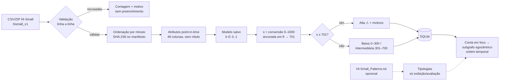

# Diário de Sprint 1 — Formalização do problema, contrato de dados e métricas
**Período:** Semana 1
**Grupo / tema:** Grupo 1 — NodeWatch: pontuação por Machine Learning (escala 0–1000, alerta a partir de 701) com motivos verificáveis e análise temporal de subgrafos egocêntricos sobre o IBM AML `HI-Small`

**Equipe:** Grupo 1
**Integrantes:** Guilherme Lombardi, Ryan dos Santos Veloso, Caio Winkler Marangoni, Guilherme Liborio Camargo
**Scrum Master do Sprint:** [PENDENTE: Inserir nome do Scrum Master da Sprint 1]
**Repositório GitHub (pesquisa/documentação):** https://github.com/Guilherme-Lombardi/AnaliseComplexidade_DeteccaoFraudes
**Sistema (código — NodeWatch):** https://github.com/NodeWatch-Team/NodeWatch — site de apresentação: https://nodewatch-team.github.io/NodeWatch/
**Especificação-base:** `docs/lfa/RFC_Grupo1_Automatos_Fraude.md` (v1.0, congelada)

> Esta sprint **só formaliza o problema**: pergunta de pesquisa, contrato de entrada do dataset, regras de integridade, especificação matemática do score e das faixas, regra de ordem temporal do grafo e métricas de avaliação. **Não há** treino de modelo, pipeline do painel nem medição de desempenho — isso é Sprint 2 e 3. O que sai daqui é o contrato que as sprints seguintes são obrigadas a respeitar.

### Contrato desta sprint

| | Artefato | Quem usa depois |
|---|---|---|
| **Entra** | RFC do Grupo 1 (v1.0, especificação-base congelada) | — |
| **Sai** | Canvas de kickoff + pergunta de pesquisa fechada | Sprint 2, 3 e 4 |
| **Sai** | Especificação formal do pipeline de pontuação: score bruto $b \in [0,1]$ (não calibrado) $\mapsto$ índice inteiro $s \in \{0, \dots, 1000\}$, linear por partes, ancorado no limiar do modelo ($\theta_{\text{bruto}} \mapsto 701$), com corte de alerta em $s \geq 701$ e faixas Baixa (0–300), Intermediária (301–700) e Alta (701–1000) | Sprint 2 **é obrigada a implementar exatamente esta conversão e estas faixas** |
| **Sai** | Contrato de entrada do dataset IBM AML: `HI-Small_Trans` no esquema `hismall_v1` (ou `transacao_hismall_v1`, com colunas em português) + `HI-Small_Patterns.txt` opcional, com regras de recusa, isolamento do rótulo, regra de moedas e janela de 72 h | Sprint 2 (atributos e treino) e Sprint 3 (pipeline do painel) |
| **Sai** | Protocolo de avaliação: divisão temporal e métricas de classe rara (Precisão, Recall, F1, Average Precision), sem Acurácia | Sprint 2 (seleção do modelo e limiar) e Sprint 4 (avaliação final) |
| **Sai** | Repositório, board, este diário | Sprints seguintes |

**Não sai daqui:** código de atributos, modelo treinado, pipeline do painel, interface, medições de desempenho.

---

## 1. Canvas de kickoff

| Pergunta | Resposta |
|---|---|
| Qual é a pergunta de pesquisa? | Em que medida um modelo de ML tabular com atributos comportamentais *point-in-time*, combinado com um subgrafo egocêntrico temporalmente ordenado e gerado sob demanda, prioriza transações de lavagem de dinheiro para o analista — medido por Precisão, Recall, F1 e Average Precision (PR-AUC) — com custo operacional por bloco compatível com uma estação local? *(Recorte de complexidade: o custo do score é constante por conta a cada transação (estado incremental O(1) ou O(grau)); o grafo é montado só para a conta em foco, com tetos fixos, então seu custo não cresce com o tamanho do dataset. A busca global de ciclos — exponencial no pior caso — fica fora do pipeline.)* |
| Qual é a entrada do modelo (atributos por transação)? | 49 atributos calculados só com minutos estritamente anteriores ao da transação: 27 comportamentais (valor em USD, envios e recebimentos da origem e do destino em janelas de 6/24/72 h, par origem→destino novo e nº de transações prévias do par, destinos distintos da origem, origens distintas do destino, `z` do valor para a origem, minutos desde o último envio/recebimento, indicadores de sem histórico), 7 de formato de pagamento (one-hot) e 15 de moeda de pagamento (one-hot). **Rótulo (`Is Laundering`) e tipologias (`HI-Small_Patterns.txt`) nunca são atributos.** |
| O que o sistema decide sobre cada transação? | Se ela passa o limiar de alerta do modelo ($b \geq \theta_{\text{bruto}}$, equivalente a $s \geq 701$) e em que faixa de prioridade fica. Transações em alerta recebem `⚠` e motivos verificáveis por regras fixas. **Nenhuma transação é bloqueada, aprovada ou paga**: não há integração bancária, e score alto é sinal para investigação, não prova de lavagem. |
| Qual é o custo de um falso negativo e de um falso positivo? | **FN:** lavagem com $s \leq 700$ não recebe alerta e pode não ser vista — custo alto (regulatório e reputacional), mitigado pela faixa intermediária, pelo grafo da conta em foco e pela revisão humana. **FP:** transação legítima com $s \geq 701$ consome tempo do analista — custo médio de fila; não há bloqueio do cliente. Decisão ligada ao desenho: o limiar é escolhido pelo **maior F1 na validação temporal**, equilibrando os dois erros, e não fixado em 0,5 (o score bruto não é calibrado). |
| Justificativa: por que ML tabular + subgrafo egocêntrico temporal é adequado? | Lavagem é rara (≈ 0,11% das transações no teste) e depende do comportamento da conta no tempo (frequência, contrapartes distintas, valor atípico, dinheiro que entra e sai rápido). Um modelo tabular com atributos *point-in-time* captura esses sinais com custo linear no número de transações e é avaliado por métricas de classe rara. O grafo entra **na investigação**, não no score: só para a conta em foco, limitado em saltos, nós e arestas, e com cada aresta indireta classificada por ordem temporal — o que evita a explosão combinatória da busca global de ciclos e as cadeias que só existem quando se ignora o horário. |

- [x] Pergunta de pesquisa escrita sem ambiguidade
- [x] Entrada do modelo (atributos) definida e justificada, com isolamento do rótulo
- [x] Custo de FN/FP explicitado e ligado ao desenho (limiar por máximo F1, sem bloqueio automático)

## 2. Especificação formal do pipeline de pontuação e das regras de integridade

- [x] Contrato de esquema (`hismall_v1`) definido, com significado e regra de validação de cada campo
- [x] Regra de histórico mínimo de 72 h definida
- [x] Regra de não-soma entre moedas distintas definida
- [x] Regra de ordem temporal no grafo (`direta`, `sequencia`, `simultanea`, `sem_ordem`) definida
- [x] Conversão do score e faixas de risco definidas matematicamente
- [x] Diagrama do pipeline desenhado

### 2.1 Contrato de esquema `hismall_v1`

O painel aceita dois cabeçalhos para o mesmo conteúdo: `hismall_v1` (cabeçalho original do IBM AML, em inglês, com a coluna `Account` repetida para origem e destino) e `transacao_hismall_v1` (colunas em português). A tabela abaixo mostra o campo interno, a coluna de cada formato e a regra de validação.

| Campo | Coluna `hismall_v1` | Coluna `transacao_hismall_v1` | Obrigatório | Regra (linha recusada se violar) |
|---|---|---|---|---|
| `data_hora` | `Timestamp` | `timestamp` | Sim | `AAAA/MM/DD HH:MM` (hismall_v1) ou ISO 8601 / `AAAA/MM/DD HH:MM` / época em segundos; resolução de 1 minuto; fuso assumido UTC |
| `banco_origem` | `From Bank` | `banco_origem` | Sim | Inteiro (1 a 18 dígitos) |
| `conta_origem` | `Account` (1ª) | `conta_origem` | Sim | Não vazio |
| `banco_destino` | `To Bank` | `banco_destino` | Sim | Inteiro (1 a 18 dígitos) |
| `conta_destino` | `Account` (2ª) | `conta_destino` | Sim | Não vazio |
| `valor_recebido` | `Amount Received` | `valor_recebido` | Sim | Numérico, finito, $0 \leq v \leq 10^{15}$ |
| `moeda_recebimento` | `Receiving Currency` | `moeda_recebimento` | Sim | Não vazio |
| `valor_pago` | `Amount Paid` | `valor_pago` | Sim | Numérico, finito, $0 \leq v \leq 10^{15}$ |
| `moeda_pagamento` | `Payment Currency` | `moeda_pagamento` | Sim | Não vazio |
| `formato` | `Payment Format` | `formato` | Sim (coluna) | Valor vazio é aceito e exibido como "Não informado", com aviso na validação |
| `rotulo` | `Is Laundering` | `rotulo` | **Não** | Se a coluna existir: só 0 ou 1 |
| `id_transacao` | — | `id_transacao` | Não | Se existir: não vazio e único no arquivo |

**Identidade das contas.** Cada conta é o nó `banco-conta` (ex.: `011-8000F5340`), formado por `banco_origem + "-" + conta_origem` e `banco_destino + "-" + conta_destino`. A mesma conta em bancos diferentes são nós diferentes.

**Regras do arquivo.**
- CSV em UTF-8, separado por vírgula, ponto decimal; ZIP com um único CSV.
- Limites: 256 MB enviados, 2 GB descompactados; arquivo de padrões até 32 MB.
- Cabeçalho que não corresponde a nenhum dos dois formatos recusa o arquivo inteiro, com a lista de colunas que faltam. Arquivos de telemetria de rede e o CSV PaySim do grafo antigo (`step,type,amount,nameOrig,nameDest`) são recusados com explicação.
- **Sem preenchimento silencioso:** linha que viola uma regra é recusada e contada, com coluna, motivo, linha de exemplo e "como corrigir". A validação devolve `lidas`, `validas` e `recusadas`; o dataset fica `valido`, `valido_com_recusas` ou `invalido`.
- Linhas fora de ordem cronológica não são recusadas: a análise ordena por data e hora (empate pela ordem da linha) e avisa.
- Moedas e formatos que não existiam no treino não são recusados, mas ficam sinalizados; moeda sem taxa aprendida deixa o valor em USD ausente (`sem_taxa_cambio`), sem taxa inventada.
- O SHA-256 do arquivo é calculado e gravado no manifesto da análise.

**Isolamento do rótulo.** Seja $X$ a matriz de atributos e $y$ a coluna `rotulo`. A inferência é $b = f_\theta(X)$, com $y \notin X$. O rótulo só é usado depois da pontuação, para contar VP/FP/FN e calcular métricas, e só quando a coluna existe. O mesmo vale para as tipologias de `HI-Small_Patterns.txt`, que servem para exibição e para o recall por tipologia.

### 2.2 Regra de histórico mínimo de 72 h

Cada análise começa **sem passado anterior ao arquivo**. Seja $t_0$ o primeiro minuto observado da análise e $t$ o minuto de uma transação. Então:

$$
\texttt{historico\_incompleto}(t) =
\begin{cases}
1, & t - t_0 < 72 \times 60 \text{ minutos} \\
0, & \text{caso contrário}
\end{cases}
$$

- A transação com `historico_incompleto = 1` **é pontuada normalmente** e fica marcada; o painel informa quantas foram e avisa que o score tende a ser mais baixo (contagens das janelas de 72 h subestimadas).
- Se o arquivo cobrir menos de 72 h ($t_{\max} - t_0 < 4320$ min), a validação emite aviso; o arquivo não é recusado.
- A marca é por minuto da análise (desde $t_0$), o que equivale a "contas com menos de 72 h observadas", já que todas as contas começam a ser observadas no início do arquivo.

### 2.3 Regra de não-soma entre moedas distintas

Seja $T$ o conjunto de transações e $m(t)$ a moeda de pagamento de $t$. Toda soma exibida ao analista é feita **dentro de uma moeda**:

$$
\text{Total}(o, d, m) = \sum_{t \in T:\ \text{orig}(t)=o,\ \text{dest}(t)=d,\ m(t)=m} \text{valor\_pago}(t)
$$

- No grafo, uma aresta é a chave $(o, d, m)$: duas transações de A para B, uma em US Dollar e outra em Euro, viram **duas arestas**.
- Filtros e totais do painel são por moeda; não existe "total geral" que misture moedas.
- Dentro do modelo, os atributos de valor (`log_valor_usd`, `soma_env_origem_usd_24h`) usam conversão para USD pela taxa implícita aprendida no treino (mediana das razões recebido/pago entre moedas diferentes). Essa conversão é interna ao modelo e nunca aparece como soma na tela.

### 2.4 Regra de ordem temporal no subgrafo egocêntrico

**Montagem.** A partir da conta em foco $f$, o subgrafo é coletado por BFS no SQLite: a jusante ($f \to \dots$) e a montante ($\dots \to f$), com profundidade padrão 2 e máxima 3 saltos, até 300 contas por salto (fronteira). As transações são agrupadas em arestas $(o, d, m)$. São desenhados no máximo **30 nós** e **60 arestas**, do foco para fora, com alertas primeiro.

**Classificação de cada aresta desenhada.** Seja $\tau(e)$ o conjunto de minutos das transações da aresta $e$.

| Ordem | Definição | Desenho |
|---|---|---|
| `direta` | A aresta sai de $f$ (a jusante) ou chega em $f$ (a montante) | Contínuo |
| `sequencia` | A jusante, para $e = (B \to C)$ com $B \neq f$: existe $\min_{\tau} \in \tau(e)$ com minuto **estritamente posterior** à chegada mais cedo do dinheiro em $B$ pela cadeia que veio de $f$. A montante, para $e = (X \to Y)$ com $Y \neq f$: existe minuto **estritamente anterior** à saída mais tarde de $Y$ rumo a $f$ | Contínuo |
| `simultanea` | Não há minuto estritamente posterior (ou anterior), mas há transação **no mesmo minuto** da referência. Como o dataset tem resolução de 1 minuto, a ordem não é confirmada | Destacado como "ordem não confirmada" |
| `sem_ordem` | A conta intermediária não foi alcançada por uma sequência confirmada, ou todas as transações da aresta são incompatíveis no tempo (ocorreram antes da chegada a jusante ou depois da saída a montante) | **Tracejado** |

Formalmente, a jusante: seja $c(B) = \min\{\text{minuto da transação que levou o dinheiro a } B\}$. Então
$$
\text{ordem}(B \to C) =
\begin{cases}
\texttt{sequencia}, & \exists\, t \in \tau(B \to C):\ t > c(B) \\
\texttt{simultanea}, & \nexists\, t > c(B) \ \wedge\ c(B) \in \tau(B \to C) \\
\texttt{sem\_ordem}, & \text{caso contrário (inclui } c(B) \text{ indefinido)}
\end{cases}
$$
e simetricamente a montante, com $p(Y) = \max\{\text{minuto da saída de } Y \text{ rumo a } f\}$ e a condição $t < p(Y)$.

**Consequências.** Uma cadeia $f \to B \to C$ só é afirmada se os horários permitirem que o dinheiro tenha passado por $B$ antes de seguir para $C$. Uma sequência que volta a $f$ ("volta ao foco") só é registrada se cada passo for posterior ao anterior. Horário compatível **não prova** que é o mesmo dinheiro. A disposição do desenho (circular, leque ou camadas) vem só da tipologia registrada no arquivo de padrões e nunca é deduzida da forma do grafo.

### 2.5 Conversão do score e faixas de risco

**Autômato substituído por função.** O antigo $M = (Q, \Sigma, \delta, q_0, F)$ dá lugar a uma função de decisão sobre cada transação:

$$
\text{decisão}(x) = \big(\, s(f_\theta(x)),\ \text{faixa}(s),\ \text{alerta} = [\,s \geq 701\,],\ \text{motivos}(x) \,\big)
$$

**Score bruto.** $b = f_\theta(x) \in [0, 1]$ é o `predict_proba` da classe 1 do modelo. Não é probabilidade calibrada. O único ponto de operação validado é o limiar $\theta_{\text{bruto}} \in (0, 1)$, escolhido pelo maior F1 na validação temporal (no modelo distribuído, $\theta_{\text{bruto}} = 0{,}09098$).

**Conversão para 0–1000 (linear por partes, ancorada no limiar).**

$$
s(b) =
\begin{cases}
\min\!\left(\left\lfloor \dfrac{b}{\theta_{\text{bruto}}} \cdot 701 \right\rfloor,\ 700\right), & 0 \leq b < \theta_{\text{bruto}} \\[2ex]
\min\!\left(701 + \left\lfloor \dfrac{b - \theta_{\text{bruto}}}{1 - \theta_{\text{bruto}}} \cdot 299 \right\rfloor,\ 1000\right), & \theta_{\text{bruto}} \leq b \leq 1
\end{cases}
$$

Âncoras: $s(0) = 0$; $s(\theta_{\text{bruto}}^-) = 700$; $s(\theta_{\text{bruto}}) = 701$; $s(1) = 1000$. Entrada fora de $[0, 1]$ ou ausente é erro, nunca valor corrigido.

**Faixas.**

$$
\text{faixa}(s) =
\begin{cases}
\textbf{Baixa}, & 0 \leq s \leq 300 \\
\textbf{Intermediária}, & 301 \leq s \leq 700 \\
\textbf{Alta (com alerta, ⚠)}, & 701 \leq s \leq 1000
\end{cases}
$$

| Faixa | Score | Trecho do score bruto ($\theta_{\text{bruto}} = 0{,}09098$) | Leitura para o analista |
|---|---|---|---|
| Baixa | 0–300 | $[0;\ 0{,}03907)$ | Comportamento compatível com o padrão observado; sem alerta |
| Intermediária | 301–700 | $[0{,}03907;\ 0{,}09098)$ — de ≈ 43% (301/701) a 100% do limiar | Sinais parciais abaixo do corte; sem alerta automático; área cinzenta para análise manual |
| Alta | 701–1000 | $[0{,}09098;\ 1]$ | Alerta `⚠`, com motivos verificáveis |

**Propriedades exigidas (a Sprint 2 deve testá-las).**
1. Monotonia: $b_1 \leq b_2 \Rightarrow s(b_1) \leq s(b_2)$.
2. Equivalência do corte: $s(b) \geq 701 \iff b \geq \theta_{\text{bruto}}$.
3. Dependência do limiar: scores de versões com limiares diferentes não são comparáveis; versão e limiar vão para o manifesto de cada análise.
4. O índice é **ordem de prioridade**, não probabilidade de lavagem.

**Motivos verificáveis (só para $s \geq 701$).** Regras fixas, conferíveis nos dados, que **não** são explicação do modelo: formato com taxa de lavagem no treino ≥ 5× a média; primeira transação entre origem e destino; envios da origem em 24 h acima do p99 do treino; destino com mais origens distintas que o p99; origem com mais destinos distintos que o p99; valor atípico para a origem ($|z| > 3$); origem recebeu fundos há menos de 60 min; moedas de pagamento e recebimento diferentes.

### 2.6 Diagrama do pipeline (Mermaid)

**Evidências (diagrama, link do documento/commit):** especificação versionada neste arquivo e na RFC v1.0; implementação de referência no repositório do sistema: esquemas e validação (`f526dc1`, `f6f7af9`), métricas por classe (`82134d1`), backend do painel com score e faixas (`4d3d331`). [PENDENTE: Inserir link do commit desta especificação no repositório de pesquisa]

## 3. Seleção do dataset de teste

- [x] Dataset (transações) identificado e sua origem documentada
- [x] Ground truth localizado no dataset (rótulo `Is Laundering` por transação; tipologias em `HI-Small_Patterns.txt`)
- [x] Tamanho do grafo (nós/arestas) registrado, para dimensionar o benchmark da Sprint 3

**Origem do dataset e N (nós/arestas):** IBM Transactions for Anti Money Laundering (AML), conjunto **HI-Small** (sintético, gerado pelo simulador AMLworld; Altman et al., "Realistic Synthetic Financial Transactions for Anti-Money Laundering Models", NeurIPS 2023 Datasets and Benchmarks). Fonte: Kaggle `ealtman2019/ibm-transactions-for-anti-money-laundering-aml`; licença CDLA-Sharing-1.0. Arquivos obtidos do pacote da disciplina, fora do repositório (`.gitignore` cobre `dados/HI-Small_*`).

| Item | Valor (verificado em `docs/ml/RELATORIO_ML.md`, seção 2.1) |
|---|---|
| Transações (arestas do multigrafo) | **E = 5.078.345** |
| Contas distintas (nós `banco-conta`) | **N = 515.088** |
| Positivos (`Is Laundering = 1`) | 5.177 (≈ 0,10% do total) |
| Período | 01/09/2022 00:00 a 18/09/2022 16:18 |
| Moeda de pagamento ≠ moeda de recebimento | 72.170 transações |
| Auto-transferências (origem = destino) | 591.212 (11 positivas) |
| Duplicatas exatas | 9 |
| SHA-256 de `HI-Small_Trans.zip` | `93c9d651…5179` (igual a `sha256_dados_treino` em `modelos/MANIFESTO_MODELO.json`) |

**Divisão temporal (protocolo de avaliação).**

| Split | Período | Transações | Positivos | Taxa |
|---|---|---|---|---|
| Treino | 01/09 a 07/09/2022 | 3.248.921 | 2.530 | 0,08% |
| Validação | 07/09 a 09/09/2022 | 965.524 | 1.036 | 0,11% |
| Teste | 09/09 a 11/09/2022 | 862.792 | 956 | 0,11% |
| Cauda (reportada à parte) | a partir de 11/09/2022 | 1.108 | 655 | 59% |

A cauda tem volume abaixo de 1% da mediana diária e prevalência artificial de 59%: é artefato do gerador e fica fora das métricas principais. Só negativos do treino são subamostrados (fração 0,2, peso 5); validação e teste não.

**Ground truth (onde está, quantas são):**
- **Por transação:** coluna `Is Laundering` (0/1). Usada apenas para avaliação e métricas parciais no painel, nunca como atributo.
- **Por tipologia:** `HI-Small_Patterns.txt`, com blocos `BEGIN LAUNDERING ATTEMPT - <TIPO>` … `END LAUNDERING ATTEMPT` e 8 tipologias: FAN-IN, FAN-OUT, CYCLE, STACK, SCATTER-GATHER, GATHER-SCATTER, BIPARTITE, RANDOM. São 370 tentativas; **1.968 dos 5.177 positivos não aparecem em nenhum padrão** (`sem_padrao`), e 206 das 370 tentativas atravessam a fronteira entre períodos.

**Distribuição de `Payment Format` (amostra, por taxa de lavagem):** ACH concentra ≈ 87% da lavagem (4.483 positivos em 600.797 transações, taxa 0,75%); Bitcoin 56 em 146.091; Cash 108 em 490.891. Os 7 formatos são one-hot no modelo (ACH, Bitcoin, Cash, Cheque, Credit Card, Reinvestment, Wire).

**Análise de valores ausentes / incongruências:**
- O IBM AML não traz campos vazios nas colunas obrigatórias do arquivo original; o contrato da seção 2.1 recusa qualquer linha que os tenha em arquivos enviados ao painel.
- A coluna `Account` aparece duas vezes no cabeçalho original (origem e destino); o leitor a trata como `Account` e `Account.1`.
- Fuso horário não documentado: assumido UTC; resolução de 1 minuto (origem das classes `simultanea` no grafo).
- Câmbio não é fornecido: é estimado no treino pela mediana das razões recebido/pago entre moedas diferentes.
- 9 duplicatas exatas e 591.212 auto-transferências (contas pagando a si mesmas) permanecem no dado; auto-transferência é atributo do modelo (`auto_transferencia`).

**Baseline de comparação (registrado para a Sprint 2 e 4):**
- Prevalência (alertar tudo): Precisão 0,0011, AP 0,0011 no teste.
- Taxa do formato (score = taxa de lavagem do formato no treino): Precisão 0,0070, Recall 0,8724, AP 0,0064 no teste.
- Métricas oficiais: **Precisão, Recall, F1 e Average Precision (PR-AUC)**, calculadas no teste temporal; recall por tipologia e por tentativa nova vs. iniciada antes do teste; recall@k por dia. **Acurácia não é usada**: com prevalência de 0,11%, um classificador que nunca alerta teria 99,89% de acurácia.

## 4. Prova de conceito manual

- [x] Pipeline executado "na mão" (sem código) em pelo menos 5 casos: 1 típico, 1 limítrofe, 1 alerta, 1 de grafo com ordem incompatível e 1 de arquivo sem rótulo
- [x] Resultado de cada caso confrontado com a expectativa (o desenho das regras faz sentido?)

**Tabela de casos de validação funcional** ($\theta_{\text{bruto}} = 0{,}09098389$; valores de $s$ conferidos com `src/painel/score.py::converter`):

| Caso | Entrada | Passos | Resultado | Faixa / decisão | Esperado? |
|---|---|---|---|---|---|
| 1 — Transação típica | Wire, US Dollar → US Dollar, par já usado, envios da origem dentro do habitual; $b = 0{,}01$ | $\lfloor 0{,}01 / 0{,}09098 \cdot 701 \rfloor = \lfloor 77{,}05 \rfloor$ | $s = 77$ | **Baixa** (0–300), sem alerta, sem motivos | Sim — comportamento compatível com o padrão observado |
| 2 — Caso limítrofe | ACH, par novo, poucos envios; $b = 0{,}08$ | $\lfloor 0{,}08 / 0{,}09098 \cdot 701 \rfloor = \lfloor 616{,}4 \rfloor$ | $s = 616$ | **Intermediária** (301–700), sem alerta automático | Sim — sinais parciais abaixo do corte; vai para análise manual se o analista quiser |
| 2b — Borda exata do corte | $b = \theta_{\text{bruto}}$ e $b = \theta_{\text{bruto}} - 10^{-9}$ | Primeira expressão com $\min(\cdot, 700)$; segunda com âncora 701 | $s = 701$ e $s = 700$ | Alta e Intermediária | Sim — o corte é exatamente o limiar do modelo |
| 3 — Alerta suspeito | ACH, primeira transação entre as contas, origem recebeu fundos há 12 min, moedas diferentes; $b = 0{,}30$ | $701 + \lfloor (0{,}30 - 0{,}09098)/(1 - 0{,}09098) \cdot 299 \rfloor = 701 + \lfloor 68{,}75 \rfloor$ | $s = 769$ | **Alta** ⚠, motivos: "formato com taxa de lavagem no treino >= 5x a média; primeira transação entre origem e destino; origem recebeu fundos há menos de 60 min; moedas de pagamento e recebimento diferentes" | Sim — alerta com fatos que o analista consegue conferir |
| 4 — Grafo com ordem temporal incompatível | Foco A. A→B em 10/09 10:05 (USD). B→C só em 10/09 09:50 (USD). B→D em 10/09 10:05 (USD) | A→B: sai do foco ⇒ `direta`; $c(B) = $ 10:05. B→C: nenhum minuto > 10:05 e nenhum = 10:05 ⇒ `sem_ordem`. B→D: nenhum > 10:05, mas há = 10:05 ⇒ `simultanea` | A→B contínua; B→C **tracejada**; B→D "ordem não confirmada" | Nenhuma sequência afirmada | Sim — B→C aconteceu antes de o dinheiro chegar a B; o grafo não sugere a cadeia falsa A→B→C |
| 4b — Sequência confirmada | Mesmo foco; B→E em 10/09 11:30 | 11:30 > 10:05 ⇒ `sequencia` | A→B→E registrada como sequência a jusante | — | Sim — horários compatíveis (não prova que é o mesmo dinheiro) |
| 5 — CSV válido sem `Is Laundering` | Cabeçalho `hismall_v1` sem a última coluna; 1.000 linhas válidas | Formato reconhecido; `rotulo.disponivel = false` ("o dataset não tem coluna de rótulo") | Análise roda normalmente; scores, faixas e alertas iguais aos do mesmo arquivo com rótulo | Sem métricas do dataset (VP/FP/FN, Precisão, Recall) | Sim — o rótulo não é necessário para pontuar, o que comprova o isolamento |
| 6 — Linha inválida | Linha com `Amount Paid = -50` e outra com `Payment Currency` vazia | Regras da seção 2.1 | 2 linhas recusadas, com coluna, motivo e "como corrigir"; demais válidas | Dataset `valido_com_recusas` | Sim — nada é corrigido em silêncio |
| 7 — Moedas distintas no mesmo par | A→B 100 US Dollar às 10:00 e A→B 90 Euro às 10:10 | Agrupamento por $(o, d, m)$ | Duas arestas: (A, B, US Dollar) total 100; (A, B, Euro) total 90 | Nenhum total "190" | Sim — sem soma entre moedas |
| 8 — Histórico curto | Transação 30 h depois do primeiro minuto do arquivo | $t - t_0 = 1800 < 4320$ | `historico_incompleto = 1`; pontuada normalmente | Aviso na análise | Sim — o analista sabe que as janelas de 72 h estão subestimadas |

## 5. Scrum

- [ ] Papéis definidos (Product Owner = docente; Scrum Master do sprint; Development Team)
- [ ] Board criado (GitHub Projects ou Trello) com To do / Doing / Done
- [x] Backlog inicial com pelo menos 3 user stories

**User stories do backlog inicial:**
1. Como analista de PLD, quero que o arquivo `HI-Small` seja validado linha a linha, com o motivo de cada linha recusada e sem preenchimento silencioso, para confiar que o score foi calculado sobre dados íntegros. *(Alto impacto — contrato de entrada da seção 2.1.)*
2. Como analista, quero cada transação com um score de 0 a 1000, a faixa (Baixa/Intermediária/Alta) e, nas que passam de 701, o `⚠` e motivos verificáveis, para decidir por onde começar a investigação. *(Alto impacto — especificação da seção 2.5, obrigatória para a Sprint 2.)*
3. Como analista, quero ver o subgrafo da conta em foco com as arestas marcadas por ordem temporal (`direta`, `sequencia`, `simultanea`, `sem_ordem`), para não confundir uma relação qualquer com uma cadeia de lavagem. *(Alto impacto — seção 2.4, entregue na Sprint 3.)*
4. Como pesquisador, quero o protocolo de avaliação fechado (divisão temporal, Precisão, Recall, F1, AP, sem Acurácia, baselines), para comparar modelos sem vazamento e sem métrica enganosa. *(Baixo esforço/alto impacto.)*
5. Como equipe, quero o board configurado (To do/Doing/Done) e os papéis registrados (PO = docente; Scrum Master; Dev Team), para rastrear as entregas. *(Baixo esforço/alto impacto.)*

**Link do board:** [PENDENTE: Inserir link do board (Jira/Trello/GitHub Projects)]

## 6. Diário de bordo (retrospectiva individual)

| Integrante | O que fiz nesta Sprint | Dificuldades | O que pretendo manter/ajustar |
|---|---|---|---|
| Guilherme Lombardi | [PENDENTE: Inserir registro diário] | [PENDENTE: Inserir dificuldades/ impedimentos] | [PENDENTE: Inserir o que manter/ajustar] |
| Ryan dos Santos Veloso | [PENDENTE: Inserir registro diário] | [PENDENTE: Inserir dificuldades/ impedimentos] | [PENDENTE: Inserir o que manter/ajustar] |
| Caio Winkler Marangoni | [PENDENTE: Inserir registro diário] | [PENDENTE: Inserir dificuldades/ impedimentos] | [PENDENTE: Inserir o que manter/ajustar] |
| Guilherme Liborio Camargo | [PENDENTE: Inserir registro diário] | [PENDENTE: Inserir dificuldades/ impedimentos] | [PENDENTE: Inserir o que manter/ajustar] |

## 7. Evidências gerais

- Link do canvas/RFC atualizado: `docs/lfa/RFC_Grupo1_Automatos_Fraude.md` (v1.0) — [PENDENTE: Inserir link público do arquivo no repositório]
- Link da especificação formal (score, faixas, esquema, ordem temporal): seção 2 deste diário — [PENDENTE: Inserir link do documento/commit da especificação]
- Link de commits desta Sprint: [PENDENTE: Inserir lista de commits da Sprint 1 (hash + descrição)]
- Link do board atualizado: [PENDENTE: Inserir link do board atualizado]
- Sistema (implementação de referência): https://github.com/NodeWatch-Team/NodeWatch — esquema `docs/ml/esquemas/hismall_v1.json`, validação `src/painel/datasets.py`, conversão do score `src/painel/score.py`, ordem temporal `src/painel/armazenamento.py`

## 8. Registro de revisão (v4 → v5)

- **Escopo migrado:** de pré-filtro DFA/CEP sobre componentes fracamente conexos (PaySim, Kosaraju/DFS) para ML tabular com score 0–1000 e subgrafo egocêntrico com ordem temporal (IBM AML `HI-Small`), conforme a RFC v1.0.
- **Seção 2 reescrita:** a 5-tupla, a tabela de transição e o diagrama de estados foram substituídos pelo contrato `hismall_v1`, pelas regras de 72 h, de moedas e de ordem temporal, pela conversão do score e pelas faixas, e por um diagrama do pipeline.
- **Dataset trocado:** PaySim (amostra de 16 transações) deu lugar ao `HI-Small` completo (5.078.345 transações, 515.088 contas), com N e E registrados — o item que estava pendente na v4.
- **Casos manuais:** as 7 palavras do DFA deram lugar a 10 casos de validação funcional, incluindo os 5 obrigatórios.
- **Equipe:** Julia Emily Leonardo Barbosa saiu do grupo; integrantes e diário de bordo ficaram com 4 pessoas.
- O histórico das versões v1–v4 (DFA) permanece no controle de versão do repositório de pesquisa.

---

## Rubrica de avaliação — Sprint 1 (nota de 0 a 4,0)

| Critério | Peso | O que caracteriza nota máxima | Nota atribuída | Observações |
|---|---|---|---|---|
| Canvas e pergunta de pesquisa | 0,5 | Pergunta sem ambiguidade; alfabeto e custo de FN/FP explícitos | | |
| Especificação formal do DFA | 1,5 | 5-tupla completa, diagrama de estados, linguagem reconhecida bem descrita | | |
| Dataset de teste selecionado | 1,0 | Origem documentada, ground truth localizado, N registrado | | |
| Scrum + diário de bordo | 1,0 | Papéis, board, backlog e diário reflexivo de todos | | |
| **Nota final da Sprint 1** | **4,0** | | **___ / 4,0** | |

> **Correspondência com o escopo atual** (a rubrica foi mantida literalmente, como fornecida pela disciplina): "alfabeto" → entrada do modelo (seção 1); "Especificação formal do DFA" → seção 2 (contrato de esquema, regras de 72 h, moedas e ordem temporal, conversão do score e faixas, diagrama do pipeline); "linguagem reconhecida" → definição matemática das faixas e do corte em 701 (seção 2.5); "N registrado" → N = 515.088 contas e E = 5.078.345 transações (seção 3).

---

## Registro de Revisão e Sincronização com o Código

| Seção / Item | Antes | Depois | Evidência no Código |
|---|---|---|---|
| Título e tema | "Formalização do autômato"; pré-filtro DFA/CEP para Kosaraju | "Formalização do problema, contrato de dados e métricas"; ML 0–1000 + subgrafo egocêntrico temporal | RFC v1.0 (`docs/lfa/RFC_Grupo1_Automatos_Fraude.md`) |
| Integrantes | 5 (com Julia Emily Leonardo Barbosa) | 4; o prompt pedia "os 5 integrantes", mas a Julia não faz mais parte do grupo | Informação da equipe |
| Sistema-base | `1s4ntos/Sistema-de-Detec-o-de-Fraudes-em-Transa-es-Financeiras`, commit `90be391` | `NodeWatch-Team/NodeWatch` (remoto atual) + site | `git remote -v` |
| Contrato da sprint | 5-tupla do DFA + dataset PaySim com SCCs | Canvas; especificação do score (b ↦ s, corte 701, faixas); contrato `hismall_v1` + `Patterns`; protocolo de avaliação | `src/painel/score.py`, `src/painel/datasets.py`, `src/ml/config.py` |
| Alfabeto Σ | {CASH_IN, CASH_OUT, DEBIT, PAYMENT, TRANSFER} | 49 atributos *point-in-time* (27 + 7 + 15), sem rótulo nem tipologia | `src/ml/preparacao.py` (`atributos_financeiros`), `MANIFESTO_MODELO.json` (`"colunas": 49`) |
| Esquema de entrada | `step,type,amount,nameOrig,nameDest,isFraud` | `hismall_v1` e `transacao_hismall_v1`; PaySim recusado pelo painel | `datasets.py` (`MAPA_HISMALL`, `MAPA_PT`, `identificar`) |
| Regras de recusa | Normalização de `type`; símbolo fora de Σ ⇒ aceito | Data, banco inteiro, conta/moeda não vazias, valor 0..1e15, rótulo 0/1, id único; contagem lidas/válidas/recusadas | `datasets.py` (`ler_validando`) |
| Formato de pagamento vazio | — | Aceito e exibido como "Não informado", com aviso (o código prevalece sobre `docs/ml/ANALISE_DATASETS.md:69`, que diz que formato vazio é recusado) | `datasets.py` (`ler_validando`, aviso `sem_formato`) |
| Limites do arquivo | — | 256 MB enviados, 2 GB descompactados, 32 MB para padrões | `datasets.py` (`LIMITE_BYTES`, `LIMITE_DESCOMPACTADO_BYTES`, `LIMITE_PADROES_BYTES`) |
| Janela de 72 h | — (resumo: "mínima por conta") | Marca `historico_incompleto` quando $t - t_0 < 4320$ min desde o início da análise; não recusa; aviso se o arquivo cobre < 72 h | `src/ml/incremental.py:231`, `datasets.py` (aviso de cobertura) |
| Moedas | — | Arestas e totais por $(o, d, m)$; USD só dentro do modelo, por taxa implícita | `src/painel/armazenamento.py` (agrupamento por `moeda_pagamento`), `src/ml/preparacao.py` (câmbio) |
| Ordem temporal | — | `direta`, `sequencia` (minuto estritamente posterior/anterior), `simultanea` (mesmo minuto), `sem_ordem` (tracejada) | `armazenamento.py` (`_ordem_temporal`, `ORDEM_TEXTO`) |
| Tetos do grafo | — | Profundidade 2 (máx. 3), fronteira 300, 30 nós, 60 arestas | `armazenamento.py` (`GRAFO_*`) |
| Função de decisão | $M = (Q, \Sigma, \delta, q_0, F)$, 3 estados | $s(b)$ linear por partes; faixas 0–300 / 301–700 / 701–1000; $s \geq 701 \iff b \geq \theta$ | `score.py` (`converter`, `faixa`, `SCORE_ALERTA`) |
| Limiar | — | $\theta_{\text{bruto}} = 0{,}09098389273779739$ | `modelos/MANIFESTO_MODELO.json` (`limiar_alerta`) |
| Início da faixa intermediária | — | $b = 0{,}03906726$ (calculado) | `score.py` (`descricao_conversao`) |
| Motivos verificáveis | — | 8 regras fixas, só com alerta | `src/ml/preparacao.py` (`motivos`), `src/ml/previsao.py` |
| Dataset | PaySim; amostra de 16 transações, N = 15, E = 16 | HI-Small: E = 5.078.345, N = 515.088, 5.177 positivos | `docs/ml/RELATORIO_ML.md` (seção 2.1) |
| Ground truth | 3 SCCs fraudulentas da amostra | `Is Laundering` + 8 tipologias em `Patterns`; 1.968 positivos sem padrão | `docs/ml/RELATORIO_ML.md`, `src/painel/tipologias.py` |
| Divisão temporal | — | Treino até 07/09, validação até 09/09, teste até 11/09, cauda à parte | `ml_config.exemplo.toml`, `src/ml/config.py` |
| Métricas | FN/FP de componentes; nós/arestas | Precisão, Recall, F1, AP; sem Acurácia; baselines de prevalência e de formato | `src/ml/avaliacao.py`, `docs/ml/resultados/avaliacao_lavagem.json` |
| Casos manuais | 7 palavras do DFA | 10 casos (5 obrigatórios + borda, sequência confirmada, recusa, moedas, 72 h); valores de $s$ conferidos executando `converter` | `score.py`; ordem temporal: `testes/painel/test_ordem_valor_score.py::test_so_e_sequencia_o_que_tem_horario_compativel`; teste sem rótulo: `testes/painel/test_api_painel.py::test_sem_rotulo_nao_ha_metricas_do_dataset` |
| Diário de bordo | 5 linhas | 4 linhas | — |
| Rubrica | Texto original | Mantida literalmente, com nota de correspondência abaixo | — |

- [REVISAR: a rubrica foi mantida literalmente ("alfabeto", "Especificação formal do DFA", "linguagem reconhecida") porque é o instrumento da disciplina; confirmar com o docente se ela pode ser lida pela nota de correspondência ou se precisa ser reescrita.]
- [REVISAR: `docs/ml/ANALISE_DATASETS.md:69` diz que linha com formato vazio é recusada, mas o painel (`src/painel/datasets.py`) aceita e mostra "Não informado". Este diário segue o código; vale corrigir o documento de ML ou o código para que concordem.]
- Os casos 4 e 4b têm a mesma estrutura do teste automatizado `testes/painel/test_ordem_valor_score.py::test_so_e_sequencia_o_que_tem_horario_compativel` (A→B às 12:00; B→C às 11:00 ⇒ `sem_ordem`; B→D às 12:00 ⇒ `simultanea`; B→E às 12:30 ⇒ `sequencia`), que já valida a regra no código.
