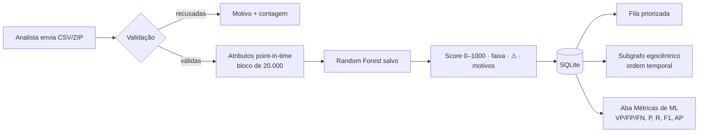

# Diário de Sprint 3 — Avaliação do modelo de ML, análise de erros e benchmark operacional
**Período:** Semanas 3–4
**Grupo / tema:** Grupo 1 — NodeWatch: pontuação por Machine Learning (escala 0–1000, alerta a partir de 701) com motivos verificáveis e análise temporal de subgrafos egocêntricos sobre o IBM AML

**Equipe:** Grupo 1 — Guilherme Lombardi, Ryan dos Santos Veloso, Caio Winkler Marangoni, Guilherme Liborio Camargo
**Scrum Master do Sprint:** [PENDENTE: Inserir nome do Scrum Master da Sprint 3]
**Repositório GitHub:** pesquisa em https://github.com/Guilherme-Lombardi/AnaliseComplexidade_DeteccaoFraudes; sistema em https://github.com/NodeWatch-Team/NodeWatch

> Contrato de dados e score formalizados (Sprint 1); pipeline de ingestão, inferência, persistência e testes implementado (Sprint 2). Esta sprint **coloca o pipeline em uso de ponta a ponta no painel** (interface React e subgrafo egocêntrico com ordem temporal) e **mede**: a qualidade da classificação desbalanceada no corte 701, o custo operacional por bloco e a integridade da avaliação (vazamento). A comparação é sempre com a referência de rótulos e métricas da Sprint 2. **Não há** análise formal de complexidade assintótica nem redação do artigo — isso é Sprint 4.

### Contrato desta sprint

| | Artefato | Origem / destino |
|---|---|---|
| **Entra** | Pipeline implementado e testado (ingestão, atributos, inferência em blocos, score 0–1000, motivos, SQLite, API `/api/painel`) | Sprint 2 — **não reescrever do zero** |
| **Entra** | Base de avaliação e referência de rótulos (métricas do modelo e dos baselines no teste do `HI-Small`) | Sprint 2 |
| **Sai** | Pipeline integrado de ponta a ponta no painel (envio → validação → pontuação → fila priorizada → grafo da conta em foco) | Sprint 4 |
| **Sai** | Medições: métricas de classificação no corte 701 (com matriz de confusão) e desempenho operacional por bloco | Sprint 4 (análise de complexidade e artigo) |
| **Sai** | Auditoria de vazamento e integridade (SHA-256 do arquivo avaliado × treino; rótulo e tipologias fora das features) | Sprint 4 |

**Não sai daqui:** análise formal de complexidade assintótica, atualização do artigo, model card.

- [x] Confirmei que o pipeline usado é exatamente o da Sprint 2 (mesmo código, mesmo modelo `lavagem-20261102T083253Z`, mesmo limiar $\theta_{\text{bruto}} = 0{,}09098389$, mesma conversão 0–1000)

---

## 1. Integração ponta a ponta no painel

- [x] Pipeline conectado à interface: cada arquivo enviado passa por validação, pontuação em blocos e gravação no SQLite antes de chegar à fila do analista
- [x] Transações recusadas ficam de fato fora da pontuação (não só registradas) e aparecem com o motivo
- [x] Fluxo documentado (diagrama: entrada → validação → atributos → modelo → score/faixa/motivos → SQLite → fila e grafo)

**Descrição da integração:** o servidor `src/sentinel_ai.py` serve o painel em `/` (`interface/painel.html`, componentes React em `interface/assets/painel-app.js`, `painel-base.js`, `painel-grafo.js`, `painel-log.js`, `painel-secoes.js`). O analista envia o dataset, acompanha as 6 etapas com progresso medido, abre a fila ordenada por score e, ao escolher uma conta, recebe o subgrafo egocêntrico (`GET /api/painel/analises/<aid>/grafo`): BFS no SQLite com profundidade padrão 2 (máx. 3), fronteira de 300 contas por salto, até 30 nós e 60 arestas, arestas por (origem, destino, moeda) e ordem temporal `direta` / `sequencia` / `simultanea` / `sem_ordem` (tracejada). A área de log (`painel-log.js`) mostra as métricas de execução ao vivo (latência, CPU, memória, vazão) e a aba **Métricas de ML** (`painel-secoes.js`, `MetricasML`) mostra as métricas históricas do modelo e as do dataset aberto (`GET /api/painel/operacao/metricas`).

**Evidências (link do commit/notebook):** `4d3d331` (backend do painel), `be6ce9f` (testes da API e do pipeline), `c1cd135` (grafo com zoom, arrasto e dicas), `d9e33ea` (navegação por vistas), `e973a4d` (painel enxuto, log estável e inferência determinística), `db317f9` (log). Execução real registrada em `artefatos_ml/painel/analises/an-20261115T145945-6b13f2/manifesto.json` e nos logs `artefatos_ml/painel/logs/ml.jsonl` e `sistema.jsonl`.

## 2. Medições

- [x] Métricas de classificação no corte 701: Precisão, Recall, F1, Average Precision e matriz de confusão
- [x] Desempenho por bloco: atributos, inferência, gravação, total, vazão e pico de memória
- [ ] CPU e latência mediana da API registradas *(só existem ao vivo; não ficaram gravadas — ver 2.2)*
- [ ] Execução repetida (mais de uma rodada) se houver variação de tempo *(uma rodada registrada)*

**Execuções usadas nesta sprint**

| Execução | Dataset | Onde está | Uso |
|---|---|---|---|
| A — Avaliação oficial do modelo | IBM AML **HI-Small**, conjunto de **teste temporal** (09/09 a 11/09/2022): 862.792 transações, 956 positivos | `docs/ml/resultados/avaliacao_lavagem.json` (fonte das "métricas históricas" da aba Métricas de ML) | Referência de qualidade do modelo |
| B — Análise real no painel | IBM AML **LI-Small** (`LI-Small_Trans.zip`, sem arquivo de padrões): 6.924.049 transações, 3.565 positivos, 01/09 a 17/09/2022 | `artefatos_ml/painel/analises/an-20261115T145945-6b13f2/` (manifesto + `resultados.sqlite`, 2,35 GB) | Métricas do dataset no painel e benchmark operacional |
| C — Ambiente de teste | Sintético de 5.000 transações (`sintetico_5k_rotulado.csv`, gerado por `scripts/ambiente_teste.py`) | `artefatos_teste/artefatos_ml/painel/analises/an-20261115T204957-1fef33/` | Só fumaça (não serve para métrica de ML) |

As métricas da execução B foram recalculadas por script **só de leitura** sobre o `resultados.sqlite` (abertura `mode=ro&immutable=1`), com as mesmas consultas de `api_painel.py::_metricas_do_dataset`; as contagens VP/FP/FN batem com `metricas_parciais` do manifesto.

### 2.1 Métricas de Machine Learning (corte 701)

**Por que a Acurácia é descartada (justificativa formal).** Seja $\pi$ a prevalência de lavagem. O classificador trivial "nunca alerta" tem acurácia $1 - \pi$. Com $\pi_{\text{HI-teste}} = 0{,}1108\%$ e $\pi_{\text{LI}} = 0{,}0515\%$, ele atinge **99,889%** e **99,949%**, sem detectar nenhum caso. A acurácia do NodeWatch é $(VP + VN)/N$ = **99,908%** no HI-Small e **99,932%** no LI-Small — no LI-Small, **menor** que a do classificador inútil. Como $VN$ domina o numerador ($VN/N > 99{,}8\%$), a acurácia mede quase só a classe negativa e não distingue um modelo útil de um inútil. Por isso o NodeWatch usa só métricas que ignoram $VN$: Precisão $= VP/(VP+FP)$, Recall $= VP/(VP+FN)$, $F_1$ e Average Precision (área sob a curva Precisão × Recall, que avalia a **ordenação** em todos os cortes; o AP de um classificador aleatório é igual a $\pi$).

**Tabela de métricas de classificação**

| Métrica | A — HI-Small, teste oficial | B — LI-Small, painel | Baseline prevalência (HI-teste) | Baseline taxa do formato (HI-teste) |
|---|---|---|---|---|
| Transações ($N$) | 862.792 | 6.924.049 | 862.792 | 862.792 |
| Positivos rotulados | 956 | 3.565 | 956 | 956 |
| Prevalência $\pi$ | 0,1108% | 0,0515% | 0,1108% | 0,1108% |
| Alertas ($s \geq 701$) | 620 | 2.592 | — | — |
| **Precisão** | **0,6274** | **0,2751** | 0,0011 | 0,0070 |
| **Recall** | **0,4069** | **0,2000** | 1,000 | 0,8724 |
| **F1** | **0,4937** | **0,2316** | 0,0022 | 0,0139 |
| **Average Precision (PR-AUC)** | **0,4640** | **0,1746** | 0,0011 | 0,0064 |
| AP ÷ prevalência (ganho sobre o acaso) | 419× | 339× | 1× | 5,8× |
| Acurácia (só para a justificativa) | 0,99908 | 0,99932 | — | — |
| Acurácia de "nunca alertar" | 0,99889 | 0,99949 | — | — |

**Matriz de confusão no corte 701**

| | A — HI-Small, teste | | B — LI-Small, painel | |
|---|---|---|---|---|
| | **Lavagem (rótulo 1)** | **Normal (rótulo 0)** | **Lavagem (rótulo 1)** | **Normal (rótulo 0)** |
| **Alerta ($s \geq 701$)** | VP = 389 | FP = 231 | VP = 713 | FP = 1.879 |
| **Sem alerta ($s \leq 700$)** | FN = 567 | VN = 861.605 | FN = 2.852 | VN = 6.918.605 |

Falsos alertas por 10 mil transações: 2,68 (A) e 2,71 (B).

**Distribuição por faixa (execução B)**

| Faixa | Transações | Positivos | Taxa de lavagem na faixa |
|---|---|---|---|
| Baixa (0–300) | 6.902.518 | 2.206 | 0,032% |
| Intermediária (301–700) | 18.939 | 646 | 3,41% |
| Alta (701–1000) | 2.592 | 713 | 27,51% |

A taxa de lavagem cresce cerca de 107× da faixa baixa para a intermediária e 8× da intermediária para a alta: a ordenação funciona mesmo fora do conjunto de treino. O maior score observado foi **755** (score bruto máximo 0,256): a faixa 756–1000 não foi usada neste dataset.

**Análise de trade-off FN × FP na triagem AML (execução B).** Mover o corte muda quantos casos o analista recebe e quantos escapam:

| Corte (score) | Alertas | Precisão | Recall | FN (lavagem sem alerta) | FP (alertas falsos) |
|---|---|---|---|---|---|
| 301 (toda a intermediária) | 21.531 | 0,063 | 0,381 | 2.206 | 20.172 |
| 500 | 6.611 | 0,141 | 0,261 | 2.636 | 5.682 |
| 600 | 4.071 | 0,202 | 0,230 | 2.744 | 3.250 |
| **701 (corte oficial)** | **2.592** | **0,275** | **0,200** | **2.852** | **1.879** |

| Primeiras $k$ transações por score | 100 | 500 | 1.000 | 2.592 | 5.000 | 10.000 |
|---|---|---|---|---|---|---|
| Precisão@$k$ | 0,970 | 0,722 | 0,511 | 0,275 | 0,173 | 0,106 |
| Recall@$k$ | 0,027 | 0,101 | 0,143 | 0,200 | 0,242 | 0,296 |

**Interpretação dos resultados.**
- **No HI-Small (A)**, o modelo acerta 63 de cada 100 alertas e encontra 41% da lavagem, com AP 419× acima do acaso. Entre os positivos com tipologia registrada, o recall fica entre 0,55 e 0,72; o buraco é `sem_padrao` (7 de 371), que puxa o recall global para baixo (Sprint 2, seção 4).
- **No LI-Small (B)**, as métricas caem (Precisão 0,28, Recall 0,20, AP 0,17), como esperado: é **outro dataset** (outras contas, prevalência menor) e a análise começa **sem histórico anterior ao arquivo**. A ordenação continua forte no topo: das 100 transações de maior score, 97 são lavagem.
- **Efeito do histórico incompleto (B):** 2.835.891 transações (41%) foram pontuadas com menos de 72 h de observação. Nelas o recall é **0,084** (80/952) e o AP 0,056; nas demais, recall **0,242** (633/2.613) e AP 0,225. Isso confirma a regra da Sprint 1: sem passado, as contagens das janelas ficam subestimadas e o modelo alerta menos.
- **Formato de pagamento (B):** os 2.592 alertas são todos ACH (2.611 dos 3.565 positivos são ACH). Os 954 positivos em Cheque, Credit Card, Cash e Bitcoin ficaram sem alerta — o mesmo viés registrado no relatório do modelo (ACH ≈ 87% da lavagem no treino).
- **Trade-off:** na triagem AML, FN é o erro mais caro, mas o corte 701 é o único ponto validado do modelo. Baixar para 301 aumenta o recall de 0,20 para 0,38 ao custo de 8,3× mais alertas (21.531, com 94% falsos). Por isso a faixa intermediária existe: ela não alerta, mas ordena uma fila secundária para análise manual sem mudar o limiar.

### 2.2 Desempenho operacional por bloco

**Execução B** — máquina do grupo, Windows 11, Python 3.14, modelo `lavagem-20261102T083253Z` (`desempenho` e `etapas` do manifesto):

| Métrica | Valor | Fonte |
|---|---|---|
| Tamanho do bloco | 20.000 transações (termina na virada do minuto) | `tamanho_do_bloco`; `pipeline.py::BLOCO` |
| Transações pontuadas | 6.924.049 (≈ 346 blocos) | `transacoes_pontuadas` |
| Tempo de extração de atributos | 72,3 s no total → **≈ 209 ms por bloco** | `tempo_atributos_s` |
| Tempo de inferência do modelo | 22,3 s no total → **≈ 64 ms por bloco** | `tempo_inferencia_s` |
| Tempo de gravação em SQLite | 76,5 s no total → **≈ 221 ms por bloco** | `tempo_gravacao_s` |
| Tempo total da pontuação | 171,1 s (atributos + inferência + gravação) → **≈ 494 ms por bloco** | soma dos três |
| Último bloco medido | 8.437 transações: atributos 565,8 ms, inferência 37,3 ms, gravação 35,4 ms, total 638,5 ms | `ultimo_bloco` |
| Vazão da pontuação | **40.469 transações/s** | `vazao_transacoes_por_s` |
| Vazão da análise inteira | **25.112 transações/s** (6.924.049 ÷ 275,7 s) | `vazao_total_transacoes_por_s` |
| Pico de RAM do processo na pontuação | **2,68 GB** (2.680.856.576 bytes) | `pico_memoria_processo_na_pontuacao_bytes` |
| Pico de RAM do processo na análise | **3,33 GB** (3.328.819.200 bytes) | `pico_memoria_processo_bytes` |
| Uso de CPU (processo e máquina) | [PENDENTE: inserir medição real da aba Métricas de ML / Log da execução] | `GET /api/painel/operacao/desempenho` → `cpu` (só ao vivo) |
| Latência mediana da API `/api/painel` | [PENDENTE: inserir medição real da aba Métricas de ML / Log da execução] | `GET /api/painel/operacao/desempenho` → `latencias[].mediana_ms` (últimas 50 consultas por operação, só em memória) |

**Tempo por etapa (execução B)**

| Etapa | Duração | Observação |
|---|---|---|
| Leitura e validação | 24,3 s | 650 MB descompactados; 6.924.049 lidas, 0 recusadas |
| Ordenação e IDs | 1,8 s | — |
| Tipologias | pulada | sem arquivo de padrões |
| Pontuação (atributos, inferência, gravação) | 174,9 s | 63% do total |
| Índices e contagens gerais | 74,3 s | 11 passos |
| Manifesto | 0,0 s | — |
| **Total** | **275,7 s** | — |

**Leitura.** A inferência do Random Forest é a parte mais barata (13% da pontuação); os atributos incrementais (42%) e a gravação no SQLite (45%) dominam. A vazão de ~40 mil transações/s na pontuação permite processar o `HI-Small` inteiro (5,08 milhões) em cerca de 2 minutos de pontuação. A execução C (5.000 transações) teve vazão de 2.303 transações/s porque o tempo fixo de preparação domina em arquivos pequenos; ela não é representativa.

### 2.3 Repetição

Só há **uma** execução registrada do LI-Small. [PENDENTE: repetir a análise B ao menos 2 vezes e registrar média e desvio de tempos e vazão; anotar CPU e latência mediana na aba de log durante a pontuação.]

## 3. Auditoria de vazamento e integridade

- [x] SHA-256 do arquivo avaliado comparado com o da base de treino
- [x] `Is Laundering` e `HI-Small_Patterns.txt` confirmados fora das features (código, modelo salvo e execução)
- [x] Integridade do dado: linhas recusadas, moedas não somadas, histórico incompleto quantificado

**SHA-256 — o arquivo avaliado não é a base de treino**

| Arquivo | SHA-256 | Fonte |
|---|---|---|
| Base de treino do modelo (`HI-Small_Trans.zip`) | `93c9d65156a28596c756bd1395531e231c5950bbbdbfe665500bc866ed595179` | `MANIFESTO_MODELO.json` → `lavagem.sha256_dados_treino`; manifesto da análise → `modelo.sha256_treino` |
| Arquivo avaliado na execução B (`LI-Small_Trans.zip`) | `645c266a08c631e85100dcaa298e53cf34b883569a802ff1d66c1e1486974e5d` | manifesto da análise → `dataset.sha256` |
| Arquivo da execução C (`sintetico_5k_rotulado.csv`) | `7307aa64d0c4fd0badedfb258deedb20e9e818c20b2a3bd0e867570058b75949` | manifesto do ambiente de teste |
| Modelo distribuído (`modelo_unificado.joblib`) | `7cbbfd393621288e92166400f1ac9eac1575e5e24da16af26d87b6a8938059ff` | `MANIFESTO_MODELO.json` → `sha256` (conferido na instalação) |

Os hashes do treino e do arquivo avaliado são **diferentes**: a execução B não reavalia o arquivo de treino. Na execução A, a separação é temporal dentro do HI-Small (treino até 07/09, validação até 09/09, teste até 11/09/2022); o próprio relatório registra que o período de teste já foi consultado mais de uma vez e que 64% das linhas de padrão do teste vêm de tentativas iniciadas antes dele.

**Rótulo e tipologias fora das features**

| Verificação | Resultado | Evidência |
|---|---|---|
| Colunas de entrada do modelo salvo | 49 colunas; nenhuma contém "rotulo", "laundering", "padrao", "tipologia" ou "pattern" | `modelos/metadados_modelo.json` → `cabecas.lavagem.colunas_entrada` |
| Caminho do dado na pontuação | O dicionário entregue a `EstadoFinanceiro.receber` não tem `rotulo`; o rótulo só é lido depois de `score` e `alerta` | `src/painel/pipeline.py` (laço de pontuação) |
| Rótulo opcional | Mesmo arquivo sem `Is Laundering` gera os mesmos alertas | `testes/painel/test_api_painel.py::test_sem_rotulo_nao_ha_metricas_do_dataset` |
| Tipologias | Só preenchem `tipologias`, `tentativas` e `tipologia_tx`; execução B sem arquivo de padrões (`dataset.padroes = null`, etapa pulada) | `src/painel/tipologias.py`, manifesto |
| Motivos verificáveis | Usam atributos do passado, quantis e taxas do treino; nenhum usa o rótulo do arquivo avaliado | `src/ml/preparacao.py::motivos` |
| Experimento de atributos de grafo | Não alterou o modelo distribuído (rodou fora do projeto; mesmo SHA-256 do joblib) | `docs/DECISAO_GRAFOS_ML.md`, seção 3 |

**Integridade do dado (execução B):** 6.924.049 linhas lidas, 6.924.049 válidas, 0 recusadas; 15 moedas, cada aresta e total por moeda; 2.835.891 transações com `historico_incompleto` (aviso gravado no log `ml.jsonl`).

**Falsos positivos e falsos negativos (quantidade e exemplos):** na execução B, 1.879 FP e 2.852 FN no corte 701. Dos FN, 2.206 ficaram na faixa baixa e 646 na intermediária. 954 FN usam formatos diferentes de ACH, nos quais o modelo não emitiu nenhum alerta. 872 FN (952 − 80) estão no período de histórico incompleto. O estudo `docs/ml/resultados/estudo_relevancia_estrutura.json`, feito sobre esta mesma análise, mostrou que grupos fortemente conectados e ciclos no grafo da conta em foco não revelaram lavagem sem alerta (Sprint 4 detalha).

## 4. Sprint Review — checkpoint intermediário

**Incremento demonstrado ao PO (docente):** painel do analista de ponta a ponta — envio e validação do IBM AML, pontuação em blocos com progresso medido, fila por score com faixas e `⚠`, detalhes com motivos verificáveis, grafo da conta em foco com ordem temporal e aba de métricas. [PENDENTE: Inserir data e forma da demonstração]
**Feedback recebido:** [PENDENTE: Inserir feedback do PO]

## 5. Scrum

- [ ] Atualizações assíncronas semanais registradas
- [ ] Board refletindo o estado real da Sprint

**Link do board:** [PENDENTE: Inserir link do board (Jira/Trello/GitHub Projects)]

## 6. Diário de bordo (retrospectiva individual)

| Integrante | O que fiz nesta Sprint | Dificuldades | O que pretendo manter/ajustar |
|---|---|---|---|
| Guilherme Lombardi | [PENDENTE: Inserir registro diário] | [PENDENTE: Inserir dificuldades/ impedimentos] | [PENDENTE: Inserir o que manter/ajustar] |
| Ryan dos Santos Veloso | [PENDENTE: Inserir registro diário] | [PENDENTE: Inserir dificuldades/ impedimentos] | [PENDENTE: Inserir o que manter/ajustar] |
| Caio Winkler Marangoni | [PENDENTE: Inserir registro diário] | [PENDENTE: Inserir dificuldades/ impedimentos] | [PENDENTE: Inserir o que manter/ajustar] |
| Guilherme Liborio Camargo | [PENDENTE: Inserir registro diário] | [PENDENTE: Inserir dificuldades/ impedimentos] | [PENDENTE: Inserir o que manter/ajustar] |

---

## Rubrica de avaliação — Sprint 3 (nota de 0 a 4,0)

| Critério | Peso | O que caracteriza nota máxima | Nota atribuída | Observações |
|---|---|---|---|---|
| Integração do filtro | 1,0 | Pipeline funcionando de ponta a ponta, fluxo documentado | | |
| Medições comparativas | 1,5 | Tabela completa, execução repetida, interpretação consistente | | |
| Checagem de corretude | 1,0 | Ground truth conferido; perdas (se houver) investigadas e corrigidas | | |
| Sprint Review / Scrum + diário | 0,5 | Incremento demonstrado; board e diário atualizados | | |
| **Nota final da Sprint 3** | **4,0** | | **___ / 4,0** | |

> **Correspondência com o escopo atual** (a rubrica foi mantida literalmente, como fornecida pela disciplina): "Integração do filtro" → seção 1 (pipeline de ponta a ponta no painel); "Medições comparativas" → seção 2 (métricas de ML no corte 701 contra os baselines e a referência da Sprint 2, e desempenho por bloco); "Checagem de corretude" → seção 3 (auditoria de vazamento e integridade; FN e FP investigados).

---

## Registro de Revisão e Sincronização com o Código

| Seção / Item | Antes | Depois | Evidência no Código |
|---|---|---|---|
| Título e tema | "Integração e benchmark"; DFA como filtro antes do Kosaraju | "Avaliação do modelo de ML, análise de erros e benchmark operacional" | RFC v1.0; Sprints 1 e 2 |
| Equipe | Em branco | 4 integrantes (o prompt pedia 5; Julia Emily Leonardo Barbosa saiu do grupo) | Informação da equipe |
| Contrato | Pipeline com filtro; medições com/sem filtro; SCCs preservadas | Painel de ponta a ponta; métricas no corte 701 e desempenho por bloco; auditoria de vazamento | Seção 1 a 3 |
| Seção 1 | Integração do DFA | Integração painel + API + grafo egocêntrico + aba Métricas de ML | `src/sentinel_ai.py`, `src/api_painel.py`, `interface/assets/painel-*.js` |
| Métricas de ML | Nós/arestas, tempo, SCCs | Precisão, Recall, F1, AP, matriz de confusão, faixas, trade-off, precisão@k | `api_painel.py::_metricas_do_dataset` (VP/FP/FN por `score >= 701`; AP por `average_precision_score` sobre `score_bruto`) |
| Números de A (HI-Small) | — | P 0,6274; R 0,4069; F1 0,4937; AP 0,4640; VN = 861.605 (calculado: 862.792 − 389 − 231 − 567) | `docs/ml/resultados/avaliacao_lavagem.json` |
| Números de B (LI-Small) | — | P 0,2751; R 0,2000; F1 0,2316; AP 0,1746; VP 713, FP 1.879, FN 2.852, VN 6.918.605 | `artefatos_ml/painel/analises/an-20261115T145945-6b13f2/` (manifesto `metricas_parciais` + recálculo só de leitura no SQLite) |
| Acurácia | Não tratada | Descartada com prova numérica (o modelo perde para "nunca alertar" no LI-Small) | Cálculo da seção 2.1 |
| Desempenho por bloco | Tempo do Kosaraju | Bloco 20.000; atributos 72,3 s; inferência 22,3 s; gravação 76,5 s; vazão 40.469/s; pico 2,68 GB | Manifesto → `desempenho`; `pipeline.py::_fechar_pontuacao` |
| CPU e latência da API | — | Medidas só ao vivo (`MonitorRecursos`, `Latencias` em memória, últimas 50 por operação); não há registro gravado → PENDENTE | `src/painel/sistema.py`; `GET /api/painel/operacao/desempenho` |
| Corretude | SCCs fraudulentas preservadas | Auditoria de vazamento: SHA-256 avaliado ≠ treino; 49 colunas sem rótulo/tipologia; rótulo fora do laço de atributos | `MANIFESTO_MODELO.json`, `metadados_modelo.json`, `pipeline.py` |
| Score máximo | — | 755 no LI-Small (bruto máx. 0,256): faixa 756–1000 não usada | Consulta ao SQLite da execução B |
| Alertas por formato | — | 100% ACH no LI-Small | Consulta ao SQLite da execução B |
| Diário de bordo | Linha vazia | 4 integrantes | — |
| Rubrica | Texto original | Mantida literalmente, com nota de correspondência | — |

- [REVISAR: o prompt pede a avaliação "sobre o dataset IBM AML (`HI-Small`)", mas a única análise real gravada no painel é do **LI-Small** (outro conjunto do IBM AML, com prevalência menor). As métricas do HI-Small vêm da avaliação oficial do modelo (execução A), não do painel. Falta rodar o HI-Small no painel para comparar diretamente com a referência da Sprint 2.]
- [REVISAR: CPU e latência mediana da API não foram gravadas; preencher a partir da área de log do painel durante uma nova execução (os campos ficam como `[PENDENTE]`).]
- [REVISAR: só há uma rodada de benchmark; a rubrica pede execução repetida.]
- [REVISAR: a avaliação A usa um período de teste já consultado mais de uma vez (ressalva do próprio sistema); não é uma avaliação inédita.]
- [REVISAR: a rubrica foi mantida literalmente ("filtro", "corretude"); confirmar com o docente se a nota de correspondência basta.]
